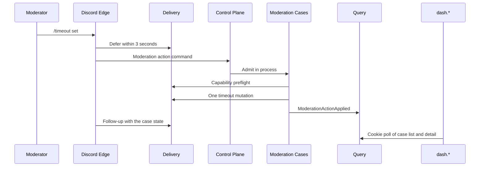

# Tobot S1 — Safety operator loop

[Roadmap](../26-implementation-roadmap.md) · [Method](../25-implementation-roadmap-method.md) · [S0 ledger](S00-platform-skeleton.md)

## Plan status

| Attribute | Value |
|---|---|
| Status | Slice demonstrated. S0 release gates stay Partial. |
| Slice | S1 — Safety operator loop |
| Outcome | A moderator applies one communication timeout in Discord and sees that case on `dash.*`. |
| Normative inputs | 02 Cases, Auto Mod, Assignment, Transport, Capability; 03 §8.6 moderation leaves and §8.7–8.8; 04 §9.9 and §9.17a; 05 §10.5; 08 §12.5 case tables; 14 invariant 232 and the Cases / Assignment rows of §25; 15 §26.1–26.4; 13 hierarchy, dual-writer, and member-role writer tests that this slice names. |
| Not opened | 16. Quarantine and lockdown are out of this slice, so that file stays closed. |
| Inherited from the running S0 | Cookie origin is `dash.tobot.test`. `admin.tobot.test` stays sessionless. User OAuth HTTP stays in Control Plane. `GET /gateway/bot` stays on Edge. Product Discord HTTP stays on Delivery. One stream `tobot:events:v1`. Consumer group `query-status-s0` / `control-plane` is not renamed. No new process. |
| Explicit dependency | The S0 working skeleton: a guild can install, Gateway ACKs an interaction, an operator can log in on `dash.*` and see the guild, and a killed worker does not lose an accepted outbox fact. |
| S0 release gates | Stay open. This plan does not mark them Complete and does not schedule the deferred evidence in `docs/architecture/runbooks/S00-operations.md`. |

This is an implementation plan, not an amendment to RFC sections 01–23. Where it conflicts with an RFC, the RFC wins.

26 §6 is the start bar for writing this file. The four skeleton facts are already demonstrated on the live database and recorded in the S0 ledger. The S0 sentence that S1 waits for every exit criterion remains the bar for calling S0 a release. It is not a ban on this plan.

## 1. Outcome

One Discord path and one `dash.*` screen:

- Discord: a guild slash command `/timeout` with `set` and `clear`. `set` applies a bounded communication timeout. `clear` removes that timeout as the compensating case of the same path.
- `dash.*`: a case list and a case detail for the selected guild. The screen reads the Query projection. It does not submit a sanction.

Timeout is the path because the operator can see it and undo it without removing the member. Kick has no inverse inside the guild. Quarantine would open Assignment and doc 16. Both stay later slices.

The defer is the interaction acknowledgement. It does not wait for Redis, the case, or the timeout HTTP call. The follow-up is a later typed Transport call on the interaction token.

## 2. Enabled modules

The install permission union grows by one named permission: Discord **Moderate Members**. Administrator stays off the union.

- New `GuildInstall` and `GuildRepair` manifests for a tenant that enables this slice request that bit together with the S0 union.
- Generations that are already `Installed` stay `Installed`. A missing Moderate Members bit is a case preflight outcome `Blocked`. It does not rewrite installation state and it does not degrade the live guilds.
- The operator grows the bit by repairing or reinstalling when they choose. Repair still admits only `Degraded` or `Removed` under the S0 rule.

Cases owns a minimal `MODERATION_POLICY` and one published revision whose `protected_targets` set is empty. Discord owner protection and role hierarchy still come from Capability. There is no policy editor in this slice.

## 3. Services and crates

No fourth process. Cases is a module inside Control Plane with its own PostgreSQL schema. Delivery keeps the bot token and remains the only Discord HTTP client for this slice.

| Place | Change |
|---|---|
| `tobot-persistence` | New `ModerationStore`. It owns case, case-event, action-receipt, and policy-revision rows, plus the case outbox. Identity, Installation, Query, Edge, and Edge relay facades do not gain these methods. |
| `tobot-envelope` | Parse the moderation leaves in §4. Unknown moderation names and `RoleAssignment*` fail closed. |
| `tobot-discord-adapter` / Delivery | Two new typed operations: moderation preflight, and apply or clear one member timeout. The Edge session client does not grow these methods. |
| `tobot-delivery-client` | Control Plane calls those two operations. Edge calls defer and follow-up, which already sit on the interaction callback client. |
| Discord Edge | Recognize `/timeout`, defer, then command-HTTP the action to Control Plane. Register the command through Delivery, the same way `probe` is registered. |
| Control Plane | Admit the action in process. Host Cases. Project case facts. Serve the case list and detail APIs. |
| `dash.*` | Guild home links to the case list and the case detail. English copy. |

Command-HTTP is Edge to Control Plane because Cases does not share the Edge process (DR-041). After admission, Cases calls Delivery and then publishes facts. The command call returns when the case row is durable, not when a later notification exists. The Discord follow-up is separate and may complete after that return.

A killed Cases worker resumes from the case row and the case outbox. It does not send a second timeout for an idempotency key that already reached `Applied`.

## 4. Inbound contracts

Live readers accept major N and N-1. N-2 fails closed.

### Commands

One §8.2 command, admitted by Cases:

| Name | Meaning |
|---|---|
| `SubmitModerationAction` | The §8.7 action request. `action_type` is `timeout` or `remove_timeout`. |

Required §8.7 fields stay required: `action_request_id`, `tenant_id`, `action_type`, `source`, `actor`, `subject`, `reason`, `policy_revision_id`, `idempotency_key`, `deadline`, `correlation_id`. `source` for this slice is `application_command`. `tenant_id` is the Installation opaque id bound from the guild on the interaction. A client-supplied tenant id is not authority.

The semantic idempotency key is tenant, interaction id, target user, action type, and the requested expiry for `timeout`. A replay returns the existing case and does not call Transport again.

These `action_type` values fail closed at admission: warn, clear warnings, kick, ban, unban, purge, slowmode, lock, unlock, quarantine, remove quarantine, remove dangerous roles.

### Facts Cases publishes

| `schema_name` | When |
|---|---|
| `ModerationCaseOpened` | The case row exists, before the provider mutation. |
| `ModerationActionAuthorized` | Preflight is `Allowed`. |
| `ModerationActionRejected` | Preflight is `Denied`. |
| `ModerationActionFailed` | Preflight is `Blocked`, or Discord confirms no effect. |
| `ModerationActionApplied` | Discord confirms the timeout or the clear. |

`ModerationCaseNoted` and `ModerationEvidenceRedacted` fail closed as live facts in this slice. So do `ModerationPolicyPublished`, every `ModerationIncident*`, every `RoleAssignment*`, and every `*Requested` name used as if it were a command.

An `OutcomeUncertain` provider result stays on the case and is reconciled from Delivery evidence. It is not published as applied. A follow-up may say the outcome is still unknown. Reconciliation does not blind-retry a timeout whose request was already transmitted.

## 5. Outbound Discord

Delivery exposes only these new operations to Control Plane:

| Operation | Discord effect |
|---|---|
| Moderation preflight | Read-only. Reports actor permission, bot Moderate Members, owner protection, role hierarchy, and the pinned `protected_targets` decision as separate facts. |
| Apply timeout | One member timeout until the admitted expiry, with a bounded audit reason that names the case. |
| Clear timeout | Remove that member's communication timeout. An already clear timeout is an idempotent no-op with a case outcome. |

Edge continues to call defer and follow-up. The follow-up text states the case display number and the primary state: applied, rejected, failed, or uncertain. It does not include tokens, raw Discord errors, or the audit-reason body beyond the sanitized reason the moderator supplied.

Cases has no method that adds or removes a member role. The Delivery client held by Cases has no role-mutation method. That is the invariant 232 boundary for this slice. Assignment is not built, so there is no second Transport client to police at runtime.

Duration is admitted only inside Discord's documented timeout maximum. A longer value is `Rejected` before any HTTP call. The command accepts a duration in English and Spanish unit tokens, the same way other Tobot parsers accept both languages. A bare number is minutes: `1` is one minute.

## 6. Data

Owner schema `moderation` in the same database. Migrations stay hand-written SQL applied by `tobot-migrate`. No other schema is altered for these tables.

Tables this slice creates, matching §12.5:

| Table | Use |
|---|---|
| `moderation.policy` | One policy per tenant. |
| `moderation.policy_revision` | Immutable revision. `protected_targets` is an empty list. `actor_capabilities` names who may run `/timeout`. |
| `moderation.case` | One row per action request. `idempotency_key` is unique per tenant. `incident_id` stays null. |
| `moderation.case_event` | Append-only. `sequence_number` unique per case. |
| `moderation.action_receipt` | The provider attempt: request id, fencing token, result class. |
| `moderation.event_outbox` | Facts from §4. |

`MODERATOR_NOTE`, `CASE_EVIDENCE_REFERENCE`, and every automatic-moderation table stay uncreated.

Case status follows §10.5 for this path only:

`Requested` → `Rejected` or `Authorized` → `Executing` → `Applied`, `Failed`, or `OutcomeUncertain`.

`Applied` moves to `Compensated` when a later `remove_timeout` case for the same member reaches `Applied`. `Rejected` and `Failed` move to `Closed`. `OutcomeUncertain` stays until reconciliation or a bounded evidence window, then `Unresolved` and `Closed`. Case rows are not deleted.

Query stores a rebuildable case summary: opaque `case_id`, tenant, display number, action, target label, status, and the projection watermark. The list and detail APIs require the same session and tenant predicate as the guild shell. A foreign tenant returns the same no-access result as the guild home.

The new consumer group is `case-status-s1`, consumer name `control-plane`, on `tobot:events:v1`. `query-status-s0` stays the installation projector. Case facts carry `guild_id` when the envelope has one.

## 7. Tests

From 13, this slice turns these proofs green. The rest of the 13 catalog stays out.

| Proof | What it shows |
|---|---|
| Hierarchy at execution | An actor who can invoke the command still gets `Rejected` when Capability reports a hierarchy or owner deny. No timeout HTTP call is made. |
| Independent decisions | The preflight report keeps actor permission, bot permission, protected-target decision, and Discord hierarchy as separate fields. |
| Dual writer | Two workers with the same idempotency key produce one case and at most one confirmed timeout. |
| Applied stays applied | A failed or missing follow-up does not move an `Applied` case to `Failed`. |
| Member-role writer | The Cases Delivery client cannot express role add, role remove, or a full role-list replace. A test that attempts those calls does not compile. |
| Deadline | `/timeout` defers inside three seconds without waiting for the timeout HTTP call or Redis. |
| Recovery | Killing Control Plane after `Executing` and before `Applied` resumes the same case. A confirmed timeout is not sent again. Recovery finishes in under 60 seconds. |
| Fail closed | Kick, ban, quarantine, and `RoleAssignmentApplied` do not parse as live S1 commands or facts. |

PostgreSQL proofs use `tobot_test`. They do not connect to the live `tobot` database.

## 8. Explicitly out of scope

- Kick, ban, unban, warn, warning decay, purge, slowmode, channel lock, and unlock.
- Quarantine, dangerous-role removal, lockdown, and any Assignment aggregate. Doc 16 stays closed.
- Auto Moderation policies, incidents, native Auto Mod rules, message deletes, and Delivery delete intents.
- Sanction DMs, activity-log messages, audit-log browsing, notes, evidence blobs, and redaction workflow.
- A dashboard form that submits a timeout. The Discord command is the only writer.
- A policy editor, a protected-target editor, and a full moderation navigation.
- A new operating-system process, a second Redis stream, or a rename of `query-status-s0`.
- Step-up authentication. This slice has no dashboard mutation, so the S0 step-up absence stays.
- Closing any S0 release gate, including duplicate delivery, slow consumer, p99, a second-replica circuit, a 7-day session wait, point-in-time recovery, CI bootstrap, and threat-review sign-off.
- Force-degrading an `Installed` guild because the permission union grew.

## 9. Demo script

1. Sign in on `https://dash.tobot.test` and open an installed guild that already has Moderate Members, or repair one guild so the new manifest is applied.
2. In Discord, run `/timeout set` on a member the moderator outranks, for a short duration and a plain reason.
3. Discord shows the deferred acknowledgement, then one follow-up with the case number and `Applied`.
4. The dash case list shows that case. The detail shows actor, target, reason, expiry, and status. A foreign tenant URL shows no access.
5. Run `/timeout clear` on the same member. The first case becomes `Compensated`. The clear case becomes `Applied`. Discord shows the member able to talk again.
6. Repeat `/timeout set` with the same invocation identity. One case exists and Discord receives one timeout.
7. Stop Control Plane with SIGKILL after a case is `Executing` and before it is `Applied`. The restarted process finishes that case once, in under 60 seconds, without a second timeout.

## 10. Work packages

Implement in this order. A later package may be reviewed early. It does not merge against an open contract from an earlier package.

### WP1 — Contracts and Moderation facade

Add the command and the five fact names. Add `ModerationStore` with the tables in §6. Cases methods live only on that facade.

**Exit:** an unknown action type and a `RoleAssignment*` fact fail closed. Two receipts with one idempotency key insert one case. The persistence crate still builds with the existing facades unchanged.

### WP2 — Delivery preflight and timeout

Add the typed preflight and the apply/clear timeout operations on the Delivery transport. Map Discord 403 to `Blocked` or `Denied` from the preflight, 429 through the existing governor, and a lost response to `OutcomeUncertain`.

**Exit:** a unit test classifies those results without a network call. Edge's `GatewaySessionStart` still has no product HTTP method.

### WP3 — Case lifecycle

Admit `SubmitModerationAction` in Control Plane. Walk §10.5 for timeout and remove-timeout. Pin the empty protected-target revision on the preflight. Publish the matching fact in the same transaction as the case event.

**Exit:** the hierarchy, dual-writer, and applied-stays-applied proofs pass on `tobot_test`.

### WP4 — Discord command

Register `/timeout` through Delivery on guild arrival. Defer, then command-HTTP, then follow-up. A duplicate interaction does not defer twice and does not open a second case.

**Exit:** the deadline proof passes. A command for a guild with no active tenant is rejected before a timeout call.

### WP5 — Case projection and dash screen

Consume case facts on `case-status-s1`. Add the list and detail routes on the guild shell. Link them from guild home.

**Exit:** an unauthenticated request is 401. A foreign tenant is no-access. The detail renders the projected status and watermark.

### WP6 — Demo hardening

Run the §9 script on one live guild. Record the case ids and the single timeout in the S0 ledger's successor note, or in this file's execution section once it exists. Leave S0 gates Partial.

**Exit:** the demo script's seven steps have a recorded result. Live `Installed` rows that were not repaired stay `Installed`.

## 11. Execution tracking

Updated as packages land. A package is Complete only when its exit evidence exists. S0 gates stay Partial.

| Package | Status | Evidence |
|---|---|---|
| WP1 — Contracts and Moderation facade | Complete | `moderation_action_and_role_assignment_fail_closed` passed. `one_idempotency_key_confirms_one_timeout` and `two_workers_with_one_key_send_one_timeout` inserted one case per key on `tobot_test`. Workspace clippy is clean. |
| WP2 — Delivery preflight and timeout | Complete | `timeout_classification_does_not_call_discord` passed. `GatewaySessionStart` still only calls `GET /gateway/bot`. Product timeout HTTP is on `TwilightTransport`. |
| WP3 — Case lifecycle | Complete | `hierarchy_deny_does_not_call_timeout`, `two_workers_with_one_key_send_one_timeout`, and `follow_up_failure_leaves_applied_unchanged` passed on `tobot_test` (2026-09-23). |
| WP4 — Discord command | Complete for the automated exit | `timeout_without_a_tenant_is_rejected_before_the_command` passed. `acknowledgement_closes_at_three_seconds` still bounds the defer window. `accept_timeout` defers and returns before command-HTTP unless the outcome is `Deferred`. After the second edge deploy, Resume published the command list on both Installed guilds (`published: 2`). |
| WP5 — Case projection and dash screen | Complete | Unauthenticated case API is 401. A signed-in session cannot open cases for a guild it cannot access. The case detail for an accessible guild shows status and watermark. |
| WP6 — Demo hardening | Complete | Case 10 was frozen `Executing` with receipt `Transmitted`, then Control Plane was SIGKILLed. The new process logged `resumed executing moderation cases` count 1 at 2026-09-23T17:09:43Z. The case reached `Applied` with one `ModerationActionApplied` and receipt `Confirmed` in under 1 second, without a second timeout. Newest guild generations stay Installed. The same-invocation proof remains the `tobot_test` dual-writer test. |

Deploy notes, 2026-09-23:

- Each discord-edge start probed `GET /gateway/bot` once, logged HTTP 429 (`retry_after_ms` about 4500, `global` false), then Resume with `remaining` 1000. The second start was required so Resume would publish `/timeout` on guilds that were already present.
- A live `/timeout set` with duration `1` returned `The action is Rejected.` and wrote no case. A bare number is now minutes. Control Plane is rebuilt for that parser; Edge is not restarted for it.
- After that parser change, guild `1507220191078252674` (OBSIDIA INTERNAL) has cases 1 and 2, both `timeout` and `Rejected`. Durations were 600s and 60s. The actor is the guild owner, so actor permission and owner protection pass. The remaining deny was role hierarchy: the bot's highest role was not above the target. No timeout HTTP was sent.
- Case 3 is `Failed` with no action receipt. It went `ModerationCaseOpened` then `ModerationActionFailed`, so preflight returned `Blocked` or `Unknown` before the timeout HTTP. The newest Installed generation still freezes `guild_permissions` `"0"`. Raising the bot role cleared hierarchy; the bot role still lacks Moderate Members.
- Case 4 is another `Failed` with no receipt. Case 5 is `timeout`, 60 seconds, `Applied`, receipt `Confirmed`, and the query projection has a watermark. The five case facts are projected.
- `/timeout clear` opened case 8 as `remove_timeout` and left it `Applied`. That clear moved cases 5, 6, and 7 from `Applied` to `Compensated`. A timeout does not become `Compensated` when its minute elapses.
- Case 10 was SIGKILLed while `Executing` and receipt `Transmitted`. Recovery resumed that one case to `Applied` / `Confirmed` with a single `ModerationActionApplied`. Edge was not restarted. Newest generations remain Installed.
- S0 release gates stay Partial.

Deviations recorded with the code, not treated as passed gates:

- `Rejected` and `Failed` are not advanced to `Closed` in this slice. `OutcomeUncertain` is not advanced to `Unresolved`.
- The case projection stores actor, reason, and expiry in addition to the minimum list.
- The member-role boundary is `cases_delivery_client_has_no_role_mutation`, which asserts the client operation names. It is not a compile-fail test.
