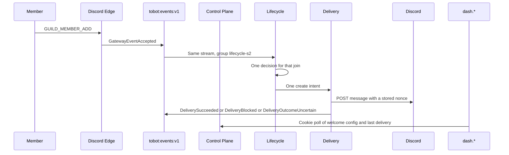

# Tobot S2 — Messaging proof

[Roadmap](../26-implementation-roadmap.md) · [Method](../25-implementation-roadmap-method.md) · [S1 ledger](S01-safety-operator-loop.md)

## Plan status

| Attribute | Value |
|---|---|
| Status | Live welcome create is proven in guild `1507220191078252674`; restart and blocked-channel parts of the S2 demo remain open. S0 release gates stay Partial. S1 stays demonstrated. |
| Slice | S2 — Messaging proof |
| Outcome | One non-bot member join posts one guild welcome message, and the operator sees that delivery on `dash.*`. |
| Normative inputs | 02 Lifecycle, Message Catalog, Delivery; 03 §8.6 lifecycle, catalog, and delivery leaves; 04 §9.3 and §9.8; 05 §10.1 and §10.2; 07 inbox/outbox; 11 backpressure for one tenant's delivery claim; 13 the delivery rows named in §7; 14 DR-012 and DR-032. |
| Not opened | Schedule, Auto Reply, departure, ban correlation, boosts, direct messages, the card renderer, and doc 16. |
| Inherited from the running S0 and S1 | Cookie origin is `dash.tobot.test`. Product Discord HTTP stays on Delivery. `GET /gateway/bot` stays on Edge. One stream `tobot:events:v1`. Consumer groups `query-status-s0` and `case-status-s1` are not renamed. Cases stay inside Control Plane. No fourth process. |
| Explicit dependency | S1: a moderator can time out a member and see the case. Delivery already performs that timeout HTTP. This slice adds the first durable guild-message intent on that same Delivery process. |
| S0 release gates | Stay open. This plan does not mark them Complete. |

This is an implementation plan, not an amendment to RFC sections 01–23. Where it conflicts with an RFC, the RFC wins.

26 §1 asks this plan to choose lifecycle join-message or auto-reply. The choice is the join message.

## 1. Outcome

One Discord path and one `dash.*` screen:

- Discord: when a non-bot member joins a guild that has a published welcome, the bot posts one plain-text message in the configured channel.
- `dash.*`: a welcome screen for the selected guild. The operator publishes the channel and the message. The screen then shows the latest delivery state. It does not send the message itself.

Auto-reply is the path not taken. Matching message text needs the privileged Message Content intent and runs on every message. Discord documents `GUILD_MEMBER_ADD` under the privileged Guild Members intent, and documents `POST /channels/{channel.id}/messages` as the create. A join is one event, not the guild's message firehose, so it does not justify a new process.

The join is not an interaction. There is no 3-second defer on this path. The dashboard publish returns when the revision is durable. It does not wait for a later join.

## 2. Enabled modules

The install permission union grows by Discord **View Channel** (`1 << 10`, `1024`) and **Send Messages** (`1 << 11`, `2048`). Moderate Members from S1 stays. Administrator stays off.

The combined guild permission string for a new install or repair is `1099511630848`.

- Generations that are already `Installed` stay `Installed`. A missing Send Messages bit is a delivery outcome `Blocked`. It does not rewrite installation state.
- Repair still admits only `Degraded` or `Removed`.

Gateway identify adds two intents to the existing `GUILDS` intent:

- `GUILD_MEMBERS` (`1 << 1`), privileged. Required for `GUILD_MEMBER_ADD`.
- `GUILD_MESSAGES` (`1 << 9`), standard. Required so a lost create can be reconciled from the `MESSAGE_CREATE` nonce. Message Content stays off.

`GUILD_MEMBERS` must already be toggled on the application in the Discord developer portal before any Edge process identifies with it. Without that toggle Discord closes the gateway with `4014`. Verified apps above 100 guilds also need Discord's approval; this bot is under that bar, so the portal toggle is the gate. The Edge binary that sends the new intent is not deployed until that toggle is confirmed. If the gateway closes `4014`, Edge stops identifying. It does not retry in a loop.

## 3. Services and crates

No fourth process. Lifecycle and the one-revision catalog live in Control Plane. Delivery owns the message intent and the only `POST /channels/{channel.id}/messages` call.

| Place | Change |
|---|---|
| `tobot-persistence` | `LifecycleStore` for the welcome revision, the join decision, and the lifecycle outbox. `DeliveryIntentStore` for the intent, attempts, nonce, and lease. Existing facades do not gain these methods. |
| `tobot-envelope` | Parse the leaves in §4. Auto-reply, schedule, departure, ban, and boost names fail closed. |
| `tobot-discord-adapter` / Delivery | One new typed operation: create one channel message with a nonce of at most 25 characters. One read: text channels for the welcome form. The Edge session client does not grow these methods. |
| Discord Edge | Identify with the intents in §2 only after the portal gate. On `GUILD_MEMBER_ADD`, store the dispatch and emit `GatewayEventAccepted`. Ignore bot joins in Lifecycle, not by dropping the gateway event. |
| Control Plane | Publish the welcome revision. Consume `lifecycle-s2`. Admit one join decision and one delivery intent. Project welcome status for the dashboard. |
| `dash.*` | Guild home links to the welcome screen. English copy. |

A killed Delivery worker resumes the same intent. A transmitted create is not posted again.

## 4. Inbound contracts

Commands that parse:

| `schema_name` | Who admits it |
|---|---|
| `PublishWelcomeRevision` | Control Plane, from the dashboard. One plain-text body, one channel id, one guild. |

Facts that parse:

| `schema_name` | Meaning |
|---|---|
| `GatewayEventAccepted` | Already live. A `GUILD_MEMBER_ADD` dispatch is the join input. |
| `LifecycleDecisionCreated` | The join was reserved. |
| `LifecycleDeliveryRequested` | One public-channel intent was committed. |
| `LifecycleEventSuppressed` | Bot join, disabled welcome, or no published revision. No Discord call. |
| `MessageDefinitionPublished` | The immutable plain-text revision. |
| `DeliveryQueued` | Intent admitted. |
| `DeliveryAttempted` | A claim started. |
| `DeliverySucceeded` | Discord returned the message. |
| `DeliveryBlocked` | Discord `403`, or the channel cannot accept the post. Terminal. |
| `DeliveryOutcomeUncertain` | The POST was sent and the response was lost. |
| `DeliveryDeadLettered` | The evidence window ended without a matching nonce. |

Fail closed, and do not admit as live commands or facts:

- `MessageDefinitionRetired`, embeds, components, polls, and asset references.
- `ScheduleActivated`, `DeliveryOccurrenceDue`, `SchedulePaused`, `ScheduleCompleted`.
- `AutoReplyMatched`, `AutoReplySuppressed`, `AutoReplyDeliveryRequested`.
- Leave, ban, and boost decisions. Those events may be stored as gateway dispatches. They do not create a welcome intent.
- `DeliveryRetryScheduled` as an automatic retry of an uncertain create. Uncertain reconciles. It does not schedule a blind second POST.
- Any `RoleAssignment*` fact. S1 already fails these closed.

`PublishWelcomeRevision` rejects an empty body, a body over 2000 characters, and a body that contains `@everyone` or `@here`. The only variable is `{member}`, replaced with the member mention `<@user_id>`.

## 5. Outbound Discord

Delivery exposes two new operations to Control Plane. Neither edits or deletes messages, and neither changes roles.

| Operation | Discord effect |
|---|---|
| List text channels | Read-only. Used by the welcome form. |
| Create channel message | One `POST /channels/{channel.id}/messages` with `content` and a stored `nonce`. |

A `403` on the create marks that intent `Blocked`. The row stays blocked. A later permission fix publishes a new intent only for a new join, with a new idempotency key. The blocked row is not edited back to `Pending`.

A `429` waits for Discord's `retry_after` through the existing governor. It is not a permission failure and it is not `OutcomeUncertain`.

A lost response, a timeout after the bytes were sent, or a `5xx` with no proof the create was refused becomes `OutcomeUncertain`. Recovery looks for a `MESSAGE_CREATE` whose nonce equals the stored nonce. A match completes `DeliverySucceeded` and does not POST again. No match before the evidence window dead-letters the intent. Replay of a dead letter is an explicit new attempt generation of the same intent, not an automatic retry.

The idempotency key is `{tenant}:{guild_id}:{user_id}:{joined_at}`. The same join reserves one decision and at most one successful create. A later rejoin has a new `joined_at` and may post again.

## 6. Data

Next migration numbers are `0016` and `0017`. Do not edit `0001` through `0015`.

`0016` creates schema `lifecycle`:

- `welcome_revision`: tenant, channel id, body, state `Published` or `Superseded`, monotonic revision. A published row is not updated in place. A newer publish inserts a row and marks the previous one `Superseded`.
- `join_decision`: unique on the idempotency key. Status `Reserved`, `Suppressed`, or `Requested`.
- `event_outbox`: same shape as the moderation outbox.

`0017` creates schema `delivery`:

- `message_intent`: pinned tenant, channel id, revision id, nonce, idempotency key, status from §10.1 reduced to `Pending`, `Claimed`, `Sending`, `Sent`, `Blocked`, `OutcomeUncertain`, `DeadLetter`.
- `message_attempt`: lease, fencing token, result class.
- Unique nonce per intent. The nonce is generated before the POST and is at most 25 characters.

Query projection `query_status.welcome_delivery` stores the latest intent status, the provider message id when Discord returned one, and the projection watermark. The dashboard reads that projection.

Consumer group `lifecycle-s2`, consumer `control-plane`, stream `tobot:events:v1`.

## 7. Tests

From 13, this slice turns these proofs green. The rest of the catalog stays out.

| Proof | What it shows |
|---|---|
| One join, one message | Two workers with the same idempotency key create one intent and at most one POST. |
| Published revision is immutable | A second publish inserts a new revision. The previous row's body does not change. An in-flight intent keeps the revision it pinned. |
| Blocked stays blocked | A Discord `403` sets `Blocked`. The same row does not return to `Pending` and is not retried. |
| Uncertain does not blind-retry | A lost create enters reconciliation. A second POST is not issued. A matching nonce completes `Sent`. A missing nonce dead-letters. |
| Broad mentions | A body containing `@everyone` or `@here` is rejected before a revision is published. |
| Bot join | A bot member produces `LifecycleEventSuppressed` and no intent. |
| Lease | Two workers cannot both hold a live fencing token on one intent. |

PostgreSQL proofs use `tobot_test`. They do not connect to the live `tobot` database.

## 8. Explicitly out of scope

- Auto-reply, message-content matching, and the Message Content intent.
- Scheduled messages, the due-row sweep, and the Durable Timer port. This slice has no due instant, so Schedule stays closed.
- Leave, ban correlation, and boost messages.
- Direct messages. A join with no DM policy records `LifecycleEventSuppressed` for the DM destination and still posts the channel message.
- Embeds, components, attachments, polls, asset bytes, and the card renderer.
- Edit and delete of the posted message.
- A fourth operating-system process, a second Redis stream, or a rename of `query-status-s0` or `case-status-s1`.
- Step-up authentication. Publishing a welcome message is an ordinary dashboard mutation: session, CSRF, and Origin. It is not in the high-risk set.
- Closing any S0 release gate, and force-degrading an `Installed` guild because the permission union grew.
- Role changes. Assignment stays unbuilt.

## 9. Demo script

1. Toggle Server Members Intent for the application in the Discord developer portal. Confirm it before the Edge image that identifies with `GUILD_MEMBERS` is started.
2. Sign in on `https://dash.tobot.test`. Open an installed guild. Publish a welcome: one text channel and `Hello {member}`.
3. Join that guild with a non-bot account, or remove and re-add one.
4. Discord shows one channel message that mentions the member. The dash welcome screen shows that delivery as `Sent`, with the message id and a watermark.
5. A second delivery of the same join event does not post a second message.
6. Stop Delivery with SIGKILL after the intent is `Sending` and before it is `Sent`. The restarted process finishes that intent once, in under 60 seconds, without a second POST when the nonce is already visible.
7. Point a new revision at a channel the bot cannot send in, and join again. That intent becomes `Blocked` and stays `Blocked`. The previous `Installed` generations stay `Installed`.

## 10. Work packages

Implement in this order. A later package may be reviewed early. It does not merge against an open contract from an earlier package.

### WP1 — Contracts

Add `PublishWelcomeRevision` and the facts in §4. Fail closed the names §4 lists.

**Exit:** an auto-reply name, a schedule name, and `@everyone` in a welcome body do not parse as a live publish. Envelope tests cover the leaves that do parse.

### WP2 — Welcome revision and join decision

Add `LifecycleStore`, migrations `0016`, and the publish path. A publish supersedes; it does not update the published body.

**Exit:** the immutability proof and the bot-join suppression proof pass on `tobot_test`.

### WP3 — Delivery create

Add the message intent, the nonce, the create POST, `Blocked`, and uncertain reconciliation.

**Exit:** the one-join, blocked, uncertain, and lease proofs pass on `tobot_test`. Edge's `GatewaySessionStart` still has no product HTTP method.

### WP4 — Member join on Edge

After the portal toggle is confirmed, identify with `GUILD_MEMBERS` and `GUILD_MESSAGES`. Emit the join. A `4014` close stops identify.

**Exit:** a recorded gateway session stays up after the new identify. A bot `GUILD_MEMBER_ADD` does not create an intent. One human join creates one intent.

### WP5 — Welcome screen

Add the dash page, the channel list, and the delivery status poll. Link it from guild home.

**Exit:** an unauthenticated request is 401. A foreign tenant is no-access. The page shows the published body and the latest status.

### WP6 — Demo

Run §9 on one live guild. Record the intent id, the message id, and the single POST in §11. Leave S0 gates Partial.

**Exit:** the seven demo steps have a recorded result. Live `Installed` rows that were not repaired stay `Installed`.

## 11. Execution tracking

Updated as packages land. A package is Complete only when its exit evidence exists. S0 gates stay Partial.

| Package | Status | Evidence |
|---|---|---|
| WP1 — Contracts | Complete | Envelope tests cover every admitted S2 fact, rejected auto-reply/schedule/role names, and broad-mention rejection. |
| WP2 — Welcome revision and join decision | Complete | `postgres_messaging`: immutable superseded revision, pinned in-flight intent, bot suppression. |
| WP3 — Delivery create | Complete | `postgres_messaging`: duplicate join, one live claim, terminal Blocked, uncertain nonce reconciliation, dead letter, tenant claim rotation, outbox projection. Two live joins each created one confirmed attempt and one Discord message. |
| WP4 — Member join on Edge | Complete | Edge emits member joins and raw `MESSAGE_CREATE` nonce; unit test checks nonce capture and terminal `4014`. The operator confirmed the portal Guild Members toggle. A fresh `Identify` completed at 20:09:10 UTC, and the human joins at 20:13:03 and 20:16:41 UTC were admitted. Bot suppression passed on `tobot_test`. |
| WP5 — Welcome screen | Complete in code | Dashboard check/build pass; the live unauthenticated GET returned 401. API uses session, tenant discovery, Origin, and CSRF guards. Live foreign-tenant and status display checks are part of WP6. |
| WP6 — Demo | Partial | Steps 1–5 were observed in guild `1507220191078252674`. The operator chose to defer steps 6–7: SIGKILL recovery and blocked-channel demonstrations. |

Local verification: `cargo test --workspace` ran against a disposable PostgreSQL 16 database named `tobot_test`; `cargo clippy --workspace --all-targets -- -D warnings`, `pnpm --filter @tobot/dash check`, and `pnpm --filter @tobot/dash build` passed. The running `tobot` database and Discord guild were not changed by these checks.

Deployment verification: images for Control Plane, Delivery, Edge, and Migrate were rebuilt; Migrate exited 0 and the live database contains `lifecycle.event_outbox`, `delivery.message_intent`, and `query_status.welcome_delivery`. The stored pre-S2 Gateway session was cleared before restarting Edge so that the new intents were sent in a fresh `Identify`.

Live welcome evidence, 2026-09-23 UTC: tenant `01a0c830-c467-70fb-a89e-40a77dc81748`, guild `1507220191078252674`, channel `1507221622891876382`, non-bot member `1084247768815644683`. The 20:13:03 join pinned revision 2, intent `01a0cfe6-7c46-74c1-8f43-91fdf78f7109`, and returned Discord message `1552412507333722193`. The 20:16:41 rejoin pinned revision 4, intent `01a0cfe9-cf8e-77dd-9274-ab8f4e9f0435`, and returned message `1552413421100597269`. Each intent has exactly one `message_attempt` with result `Confirmed`; the current `query_status.welcome_delivery` row is `Sent` for the second intent and contains its provider message id and a watermark of 20:16:42 UTC. The operator confirmed that the channel message appeared. These were two separate joins, so two messages are expected.

Live duplicate check: replayed the exact 20:16:41 `GatewayEventAccepted` envelope once into `tobot:events:v1` as Redis entry `1790194722546-0`. Consumer group `lifecycle-s2` acknowledged it with no pending entry. The original join still had one decision, one intent, and one confirmed attempt. No second create was scheduled.
