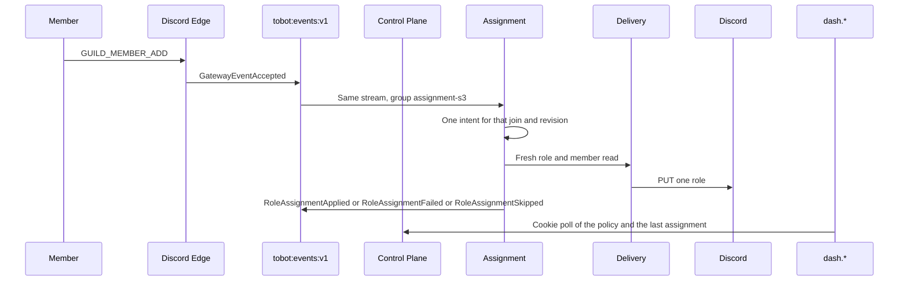

# Tobot S3 — Roles self-service

[Roadmap](../26-implementation-roadmap.md) · [Method](../25-implementation-roadmap-method.md) · [S2 ledger](S02-messaging-proof.md)

## Plan status

| Attribute | Value |
|---|---|
| Status | The S3 outcome is demonstrated: one published role was applied with one `PUT`. Replay, bot-join, SIGKILL, and the other publish rejections stay open in §11. S0 release gates stay Partial. S1 stays demonstrated. S2's welcome outcome stays demonstrated; its SIGKILL and blocked-channel demo steps stay open in that file. |
| Slice | S3 — Roles self-service |
| Outcome | One published policy adds one role when a non-bot member joins, and the operator sees that assignment on `dash.*`. |
| Normative inputs | 02 Assignment, Role Panel, Role Resource, Role Policy; 04 §9.17, §9.17a, §9.18, §9.19; 05 §10.10–10.12; 08 §12.8; 14 invariant 179, invariant 232, DR-068, DR-014, and the §25 rows for these modules; 17 §28.1–28.10 and §28.19; 13 the role rows named in §7. |
| Not opened | Role Panel, Role Resource, Schedule, quarantine, and doc 16. |
| Inherited from the running slices | Cookie origin is `dash.tobot.test`. Product Discord HTTP stays on Delivery. `GET /gateway/bot` stays on Edge. One stream `tobot:events:v1`. Consumer groups `query-status-s0`, `case-status-s1`, and `lifecycle-s2` are not renamed. Cases and Lifecycle stay inside Control Plane. No fourth process. Edge identify stays `GUILDS`, `GUILD_MEMBERS`, and `GUILD_MESSAGES`. |
| Explicit dependency | S1. Assignment is the member-role writer Cases is not allowed to be. S2 is not a dependency: the join fact is already on the bus. |
| S0 release gates | Stay open. This plan does not mark them Complete. |

This is an implementation plan, not an amendment to RFC sections 01–23. Where it conflicts with an RFC, the RFC wins.

26 §1 asks this plan to choose auto-role policy or one role panel. The choice is the auto-role policy.

Discord documents the member-role mutation as `PUT /guilds/{guild.id}/members/{user.id}/roles/{role.id}` and the matching `DELETE` for one role. Both require Manage Roles. A bot may grant only a role whose position is lower than the bot's highest role. `PATCH /guilds/{guild.id}/members/{user.id}` can carry a `roles` array; that call replaces the member's role list. 26 §2 leaves that replace off this ladder, and DR-068 rejects it.

The panel is the path not taken. Role Panel must not add or remove a member role. It would only submit a command to Assignment, and its Discord surface is a managed message with components or reactions. Delivery does not post components. Opening the panel in this slice would either call Transport from the wrong module or build a second product beside the one writer this slice exists to prove.

Role Resource stays closed for the same reason. It owns role create, edit, delete, reorder, and `DiscordRoleProjection`. It must not add or remove a member role. This slice does not write that catalog. Assignment keeps a disposable read of the guild roles and the member, taken immediately before the `PUT`.

## 1. Outcome

One Discord path and one `dash.*` screen:

- Discord: when a non-bot member joins a guild that has a published automatic-role policy, the bot adds one role to that member.
- `dash.*`: a policy screen for the selected guild. The operator publishes the role. The screen then shows the latest assignment. It does not add the role itself.

The join is not an interaction. There is no 3-second defer on this path. The dashboard publish returns when the revision is durable. It does not wait for a later join. Edge does not evaluate the policy and does not call the role endpoint. That keeps the Gateway consumer off the Discord mutation, which is the hot-path rule in module 7.24.

## 2. Enabled modules

The install permission union grows by Discord **Manage Roles** (`1 << 28`, `268435456`). Moderate Members, View Channel, and Send Messages stay. Administrator stays off.

The combined guild permission string for a new install or repair is `1099780066304`.

- Generations that are already `Installed` stay `Installed`. A missing Manage Roles bit is an assignment outcome `RoleAssignmentFailed`. It does not rewrite installation state.
- Repair still admits only `Degraded` or `Removed`.
- No new Gateway intent. `GUILD_MEMBERS` is already required for the join. Do not restart Edge for this slice unless an Edge code change exists. This plan does not require one.

The bot's highest role must sit above the target role in Discord. A target at or above that position fails at publish when the disposable read can see it, and fails again at execution if the hierarchy moved. Execution failure is terminal `RoleAssignmentFailed`, not a new revision and not an installation rewrite.

## 3. Services and crates

No fourth process. Assignment lives in Control Plane. Delivery owns the only member-role HTTP call.

| Place | Change |
|---|---|
| `tobot-persistence` | `AssignmentStore` for the policy revision, the relation claim, the intent, the attempt, and the assignment outbox. Existing facades do not gain these methods. |
| `tobot-envelope` | Parse the leaves in §4. Panel, resource, schedule, and expiry names fail closed. |
| `tobot-discord-adapter` / Delivery | One new typed mutation: add one member role. Two reads: guild roles, and one guild member. No `DELETE`, no `PATCH` of `roles`, no role create or reorder. The Edge session client does not grow these methods. The Cases delivery client does not grow them either. |
| Discord Edge | Unchanged identify. The existing `GUILD_MEMBER_ADD` `GatewayEventAccepted` is the input. |
| Control Plane | Publish the policy revision. Consume `assignment-s3`. Admit one intent. Project assignment status for the dashboard. |
| `dash.*` | Guild home links to the automatic-role screen. English copy. |

A killed Control Plane worker resumes the same intent. A `PUT` that was already transmitted is not repeated until a member read shows the role is still absent and the deadline is open.

## 4. Inbound contracts

Commands that parse:

| `schema_name` | Who admits it |
|---|---|
| `PublishAutomaticRoleRevision` | Control Plane, from the dashboard. One guild, one role id, desired state present. |

Facts that parse:

| `schema_name` | Meaning |
|---|---|
| `GatewayEventAccepted` | Already live. A `GUILD_MEMBER_ADD` dispatch is the join input. |
| `RolePolicyPublished` | The immutable revision. One role, immediate, human members. |
| `RoleAssignmentPlanned` | One intent was reserved for that join and revision. |
| `RoleAssignmentApplied` | Discord confirmed the member has the role, or a read after an uncertain `PUT` shows the role present. |
| `RoleAssignmentUnchanged` | The execution-time read already showed the role present. No `PUT`. |
| `RoleAssignmentSkipped` | Bot join, pending member, missing policy does not emit this, deadline passed, or the member is gone. |
| `RoleAssignmentFailed` | Hierarchy, Manage Roles, `@everyone`, managed, sensitive permissions, or Discord `403`. Terminal. |

A guild with no published revision consumes the join and writes nothing. That is the "no inferred default roles" branch. It is not a skipped assignment.

Fail closed, and do not admit as live commands or facts:

- Every `RolePanel*` name. The panel does not exist in this slice.
- Every `RoleResource*` name, including `RoleDependencyInvalidated`. No catalog writer.
- `RoleAssignmentScheduled`, `RoleAssignmentRetryScheduled`, `RoleAssignmentExpired`, `RoleReconciliationCompleted`.
- A `roles` array replace, a role create, and a role reorder, under any name.
- Cases-authored punitive desired state. Assignment does not open a moderation case. A fixture may insert a Cases ownership key; publish cannot.

`PublishAutomaticRoleRevision` rejects:

- A role id equal to the guild id (`@everyone`).
- A managed role.
- A role whose position is greater than or equal to the bot's highest role position.
- A role whose permission bitfield includes Administrator (`1 << 3`), Kick Members (`1 << 1`), Ban Members (`1 << 2`), Manage Channels (`1 << 4`), Manage Guild (`1 << 5`), Manage Roles (`1 << 28`), or Moderate Members (`1 << 40`).

Those bits are the sensitive classes this slice refuses. Ordinary member bits and channel-access bits may be published. Unknown future bits are not a reason to reject the role; they are also not a reason to clear them. This slice never edits a role's permissions.

The idempotency key is `{tenant_id}:{guild_id}:{user_id}:{role_id}:{revision_id}:{joined_at}`. A duplicate delivery of the same join reserves one intent. A later join, with a different `joined_at`, may reserve another intent. In-flight work stays pinned to the revision it started with. A newer publish does not edit that revision and does not remove the role from members who already have it.

## 5. Outbound Discord

Delivery exposes three new operations to Control Plane. Assignment is the only caller of the mutation.

| Operation | Discord effect |
|---|---|
| List guild roles | `GET /guilds/{guild.id}/roles`. Disposable. Not written to `DiscordRoleProjection`. |
| Read one member | `GET /guilds/{guild.id}/members/{user.id}`. Used immediately before a `PUT`, and again after an uncertain `PUT`. |
| Add one member role | `PUT /guilds/{guild.id}/members/{user.id}/roles/{role.id}`. `204` is confirmation. `X-Audit-Log-Reason` may name the revision. |

`403` is `RoleAssignmentFailed`. The intent does not return to a pending state. `429` stays inside the existing Delivery governor. It does not become a second retry schedule. A lost response or a `5xx` after the request was sent is uncertain: read the member, publish `RoleAssignmentApplied` if the role is present, and send one `PUT` only if the role is absent and the deadline is still open. There is no third attempt.

A member read of `404` publishes `RoleAssignmentSkipped` and does not `PUT`. A join whose member is `pending` publishes `RoleAssignmentSkipped` and does not create a waiting row. A bot join does the same. This slice does not consume `GUILD_MEMBER_UPDATE`, so a later screening completion does not assign the role.

The deadline is 60 seconds from `joined_at`. Work resumed after that deadline is `RoleAssignmentSkipped` and does not call Discord.

## 6. Data

Migration `0018` owns schema `assignment`. Migration `0019` adds the Query projection. Do not edit `0001`–`0017`.

Assignment owns:

- `role_policy`: one automatic policy per guild. Status `Active` or `Superseded`.
- `role_policy_revision`: immutable. Pins the role id, desired state `present`, member class `human`, screening gate `not applicable`, delay `0`, and no expiry.
- `role_relation_claim`: the ownership key for a member and role. Source is `automatic` for this product. A test fixture may insert source `cases`.
- `role_assignment_intent`: unique on the idempotency key. States follow §10.10 only as far as this slice goes: `Planned`, `Pending`, `Claimed`, `Applying`, `Applied`, `Unchanged`, `Skipped`, `Failed`, `OutcomeUncertain`.
- `role_assignment_attempt`: one row per claim, with the lease and the provider outcome.
- `event_outbox`.

Query owns `query_status.role_assignment`: tenant, guild, revision, member, role, status, provider outcome, and watermark. The dashboard reads that row. It does not read `assignment` tables.

Not created: panel tables, expiry occurrences, sticky records, reconciliation runs, role-resource mutations, and `DiscordRoleProjection`.

If a claim with source `cases` or `security` already exists for the same tenant, guild, member, and role, the automatic intent is `RoleAssignmentSkipped` and Delivery is not called. Assignment does not rewrite that claim into an automatic claim.

Lease `15` seconds. A second worker with a stale fence cannot `PUT`.

## 7. Tests

Copied from 13 for this slice:

- Duplicate member events create at most one role-assignment intent for the same desired relation and source identity.
- Automatic assignment cannot grant Administrator or the other bits §4 rejects.
- A deleted, managed, `@everyone`, or above-bot role cannot generate a provider mutation.
- A delayed rule is not admitted, so a delayed role cannot apply after this slice's deadline. Publish rejects `delay_seconds` greater than zero.
- Member-role writer proof (DR-068): the Cases delivery client still has no add or remove role operation; Assignment's only mutation is one-role `PUT`; a member `roles` replace is rejected at the adapter; Assignment has no command that opens a moderation case; a Cases ownership row outranks the automatic add for the same guild, member, and role.
- One policy does not remove a role owned by another claim. This slice has no remove operation, and superseding a revision leaves the member's role in place.
- An uncertain `PUT` reads the member before any second `PUT`. A `403` stays `Failed`.

PostgreSQL proofs use `tobot_test`. They do not connect to the live `tobot` database.

## 8. Explicitly out of scope

- Role panels, buttons, select menus, reactions, and component interactions.
- Creating, editing, deleting, or reordering roles. `DiscordRoleProjection` stays unbuilt.
- Removing a role. `DELETE` is not a Delivery operation in this slice.
- Exclusive groups, delay, expiry, sticky rejoin, invite attribution, and Membership Screening waits.
- `GUILD_MEMBER_UPDATE` as a second trigger.
- Quarantine, dangerous-role removal, and any Cases producer of assignment intents. The outrank test uses a fixture, not a sanction.
- Schedule, a due instant, and a fourth process.
- A second Redis stream, or a rename of `query-status-s0`, `case-status-s1`, or `lifecycle-s2`.
- A new privileged intent, and an Edge restart that only exists to redeploy the same identify.
- Step-up authentication. Publishing is an ordinary dashboard mutation: session, CSRF, and Origin. Administrator and the other sensitive bits cannot be selected, so this publish is not in the high-risk set.
- Closing any S0 release gate, closing the two open S2 demo steps, and force-degrading an `Installed` guild because the permission union grew.

## 9. Demo script

1. Sign in on `https://dash.tobot.test`. Open an installed guild. Publish one role that sits below the bot's highest role and does not include a bit from §4.
2. On the bot's Discord role, enable Manage Roles if it is still off. Leave the existing `Installed` generation `Installed`.
3. Join that guild with a non-bot account that is not pending Membership Screening.
4. Discord shows that role on the member. The dash screen shows `Applied`, the role id, and a watermark.
5. Replaying that same join event does not send a second `PUT`.
6. A bot join does not add the role.
7. Stop Control Plane with SIGKILL after the intent is `Applying` and before it is `Applied`. The restarted process finishes that intent once, in under 60 seconds, and does not send a second `PUT` when a member read already shows the role.
8. Publish is rejected for `@everyone`, a managed role, a role at or above the bot, and a role with Administrator. The previous `Installed` generations stay `Installed`.

## 10. Work packages

Implement in this order. A later package may be reviewed early. It does not merge against an open contract from an earlier package.

### WP1 — Contracts

Add `PublishAutomaticRoleRevision` and the facts in §4. Fail closed the names §4 lists.

**Exit:** a panel name, a role-resource name, a scheduled-assignment name, and an Administrator role do not parse as a live publish. Envelope tests cover the leaves that do parse.

### WP2 — Policy revision and join decision

Add `AssignmentStore`, migration `0018`, and the publish path. A publish supersedes; it does not update the published role id in place.

**Exit:** the immutability proof, the duplicate-join proof, the bot skip, and the Cases-ownership skip pass on `tobot_test`.

### WP3 — Delivery add-role

Add the role list read, the member read, and the one-role `PUT`.

**Exit:** the unchanged, failed, uncertain, and lease proofs pass on `tobot_test`. The Cases delivery client still has no role method. Edge's `GatewaySessionStart` still has no product HTTP method.

### WP4 — Join consumer

Consume `assignment-s3` from `GatewayEventAccepted`. Do not change Edge identify.

**Exit:** one human join creates one intent. A guild with no revision creates none. Edge logs no new identify and no role HTTP.

### WP5 — Policy screen

Add the dash page, the role list, and the assignment status poll. Link it from guild home.

**Exit:** an unauthenticated request is 401. A foreign tenant is no-access. The page shows the published role and the latest status.

### WP6 — Demo

Run §9 on one live guild. Record the intent id, the role id, and the single `PUT` in §11. Leave S0 gates Partial. Leave the open S2 demo steps in the S2 file.

**Exit:** the eight demo steps have a recorded result. Live `Installed` rows that were not repaired stay `Installed`.

## 11. Execution tracking

Updated as packages land. A package is Complete only when its exit evidence exists. S0 gates stay Partial.

| Package | Status | Evidence |
|---|---|---|
| WP1 — Contracts | Complete | `automatic_role_publish_rejects_sensitive_and_closed_names` accepts one valid `PublishAutomaticRoleRevision`. It rejects `@everyone`, a managed role, a role at the bot's position, permissions `8`, and `delay_seconds` 30. `RolePanelPublished`, `RoleResourceMutationRequested`, and `RoleAssignmentScheduled` do not parse. |
| WP2 — Policy revision and join decision | Complete | On `tobot_test`, `revision_is_immutable_and_duplicate_join_is_one_intent`: role id `200` stays `200` after a later revision `201`, and two joins with the same token share one intent. `no_revision_writes_nothing_and_bot_or_cases_skip`: no revision writes zero intents; a bot join and a `cases` ownership row skip with `put_count` 0. Live `_sqlx_migrations` has versions 18 and 19, both successful. |
| WP3 — Delivery add-role | Complete | On `tobot_test`, `unchanged_failed_uncertain_and_lease`: `Unchanged` emits `RoleAssignmentUnchanged` and inserts no automatic claim; `Failed` stays `Failed` and is not claimed again; `OutcomeUncertain` writes no public fact and is reclaimed only after the 15-second lease; a stale fence cannot extend that lease. `one_fence_transmits_once_and_a_read_does_not_put_again`: one fence transmits once, an applied-from-read finish leaves `put_count` 1, and a later revision leaves the automatic claim. Adapter `assignment_step_reads_before_a_second_put`. Delivery client `assignment_delivery_is_one_role_add`. Cases client `cases_delivery_client_has_no_role_mutation`. |
| WP4 — Join consumer | Complete | Live join on guild `1507220191078252674` created one intent, `01a0d07f-77e4-737c-a5ac-201b9e6737e5`, at 2026-09-23T23:00:09Z. One `Transmitted` attempt, `put_count` 1. `discord-edge` was not recreated for this slice. |
| WP5 — Policy screen | Partial | `pnpm --filter @tobot/dash check` and `build` passed. Unauthenticated `GET /guild/01a0c830-c467-70fb-a89e-40a77dc81748/roles` is 302 to `/auth/login`. An unknown path under that guild is 404. Unauthenticated `GET /api/v1/guilds/01a0c830-c467-70fb-a89e-40a77dc81748/roles` is 401. The projection the page reads is `Applied` for role `1507223745973190726`, watermark 2026-09-23T23:00:11Z. A signed-in foreign-tenant check was not run. |
| WP6 — Demo | Partial | Steps 1–4 remain as recorded. On 2026-11-09 `publish_role` rejected `@everyone` (role id equal to the guild), a managed role, and permissions `8` before opening a transaction. Role revision count stayed unchanged, role `1507223745973190726` stayed the only published revision, and generation 11 stayed `Installed`. Replay of the same join, a bot join, and SIGKILL during `Applying` stay open: no live join was available. |
