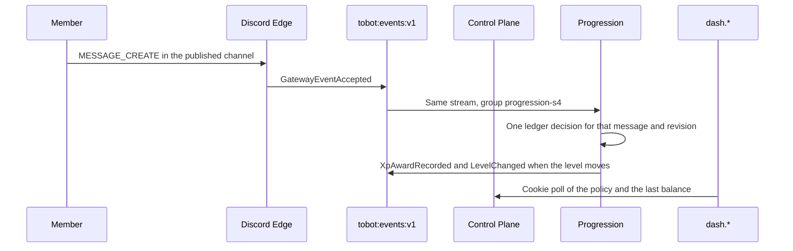

# Tobot S4 — One community vertical

[Roadmap](../26-implementation-roadmap.md) · [Method](../25-implementation-roadmap-method.md) · [S3 ledger](S03-roles-self-service.md)

## Plan status

| Attribute | Value |
|---|---|
| Status | WP1, WP2, and WP4 are complete. WP3 and WP5 are partial. WP6 recorded the live award and still has the remaining demo steps open. S0 release gates stay Partial. S1 stays demonstrated. S2's welcome outcome stays demonstrated; its SIGKILL and blocked-channel demo steps stay open in that file. S3's one-role outcome stays demonstrated; its replay, bot-join, SIGKILL, and remaining publish rejections stay open in that file. |
| Slice | S4 — One community vertical |
| Outcome | One published policy awards a fixed amount of XP for one human message in one channel, and the operator sees that member's balance on `dash.*`. |
| Normative inputs | 02 Engagement Progression only; 18 §29.4, §29.5, §29.7; 03 §8.16 and the Progression leaf names; 14 invariant 55, the §25 Engagement Progression row; 13 the XP rows named in §7. |
| Not opened | Starboard, Giveaway, Form Workflow, Temporary Room, voice progression, leaderboards, and doc 09. |
| Inherited from the running slices | Cookie origin is `dash.tobot.test`. Product Discord HTTP stays on Delivery. `GET /gateway/bot` stays on Edge. One stream `tobot:events:v1`. Consumer groups `query-status-s0`, `case-status-s1`, `lifecycle-s2`, `assignment-s3`, and `role-status-s3` are not renamed. Cases, Lifecycle, and Assignment stay inside Control Plane. No fourth process. |
| Explicit dependency | S2 and S3, as 26 §1 lists them. This slice does not call Delivery and does not call Assignment. The message observation is the dependency that is still missing on the bus. |
| S0 release gates | Stay open. This plan does not mark them Complete. |

This is an implementation plan, not an amendment to RFC sections 01–23. Where it conflicts with an RFC, the RFC wins.

26 §1 asks this plan to choose starboard or XP, not both. The choice is text XP for one channel.

Starboard is the path not taken. A board counts unique reactions and then asks Delivery to create, edit, or delete a projection message. Edge does not emit reaction events. `GUILD_MESSAGE_REACTIONS` is not in the running identify. Opening the board in this slice would add an intent, an Edge restart for that identify, and a second Discord write beside the one ledger this slice exists to prove.

Text XP fits the bus that already exists. The running identify is `GUILDS`, `GUILD_MEMBERS`, and `GUILD_MESSAGES`. Edge receives `MESSAGE_CREATE` and today stores it only when the payload carries a nonce, which is how the bot's own welcome message is reconciled. A member message has no such nonce, so it is dropped. This slice stores that member message's identity. It does not read message content, and it does not add `MESSAGE_CONTENT`.

## 1. Outcome

One Discord path and one `dash.*` screen:

- Discord: a non-bot, non-webhook message in the one published channel adds one fixed XP amount to that author.
- `dash.*`: a policy screen for the selected guild. The operator publishes the channel and the amount. The screen then shows the latest member balance and level. It does not award XP itself.

There is no Discord mutation on this path. There is no 3-second defer. The dashboard publish returns when the revision is durable. It does not wait for a later message. Edge does not evaluate the policy and does not write the ledger.

## 2. Enabled modules

The install permission union does not grow. The string for a new install or repair stays `1099780066304`.

The Gateway identify does not grow. It stays `GUILDS`, `GUILD_MEMBERS`, and `GUILD_MESSAGES`.

- Generations that are already `Installed` stay `Installed`. This slice does not repair them and does not add a permission bit.
- Repair still admits only `Degraded` or `Removed`.
- One Edge deploy is required, because member `MESSAGE_CREATE` is dropped today. That deploy keeps the same identify. It is not a restart that only redeploys the current binary, and it is not a new privileged intent.

## 3. Services and crates

No fourth process. Progression lives in Control Plane. Delivery is not a caller. Assignment is not a caller.

| Place | Change |
|---|---|
| `tobot-persistence` | `ProgressionStore` for the policy revision, the append-only ledger, the member balance, and the progression outbox. Existing facades do not gain these methods. |
| `tobot-envelope` | Parse the leaves in §4. Starboard, voice, leaderboard, adjustment, and reward names fail closed. |
| Discord Edge | Store a guild `MESSAGE_CREATE` that has an author and a channel, including one that has no nonce. The payload is the identity in §4. Do not copy content, embeds, attachments, or stickers. The existing nonce path used by welcome reconcile stays. |
| Control Plane | Publish the policy revision. Consume `progression-s4`. Admit one ledger decision. Project the member balance for the dashboard. |
| `dash.*` | Guild home links to the progression screen. English copy. |

A killed Control Plane worker resumes from the same `GatewayEventAccepted`. The ledger insert is the commit. A second delivery of the same message does not insert a second award.

## 4. Inbound contracts

Commands that parse:

| `schema_name` | Who admits it |
|---|---|
| `PublishProgressionRevision` | Control Plane, from the dashboard. One guild, one channel id, one positive award. |

Facts that parse:

| `schema_name` | Meaning |
|---|---|
| `GatewayEventAccepted` | Already live. A `MessageCreate` dispatch is the text input once Edge stores member messages. |
| `ProgressionPolicyPublished` | The immutable revision. One channel, one fixed award, human authors, no content rule. |
| `XpAwardRecorded` | One append-only ledger entry for that message and revision. Carries the §8.16 fields this slice fills. |
| `LevelChanged` | Emitted only when `level_after` is greater than `level_before`. Zero reward occurrences. |

`GatewayEventAccepted` for `MessageCreate` carries `channel_id`, `message_id`, `author_id`, `author_bot`, and `webhook`. It does not carry content. A bot nonce, when present, may stay on the same object so the welcome reconcile still finds it. Lifecycle keeps consuming only `GuildMemberAdd`. Assignment keeps consuming only `GuildMemberAdd`.

A guild with no published revision consumes the message and writes nothing.

A message whose channel is not the published channel writes nothing. The configured channel is the only source that produces a decision.

Inside that channel, one source message produces one decision under the pinned revision:

- A human, non-webhook author gets `XpAwardRecorded` with `delta` equal to the published award.
- A bot or a webhook gets a skipped decision with `delta` 0. It does not change the balance or the level. Replay of that same message stays skipped.

Fail closed, and do not admit as live commands or facts:

- Every `Starboard*` name.
- `XpAdjustmentRecorded`, `LevelRewardRequested`, `VoiceProgressionSessionChanged`, `LeaderboardRefreshRequested`.
- Giveaway, form, temporary-room, currency, and income names. They stay unsupported.
- A content-dependent rule, a cooldown, a multiplier, a ceiling, a random range, a reward role, and an announcement channel, under any field of `PublishProgressionRevision`.

`PublishProgressionRevision` rejects:

- An award below 1 or above 100.
- A missing or blank channel id.
- `cooldown_seconds` other than 0.
- A multiplier other than 1.
- Any content rule, voice source, reward role, or announcement channel.

The idempotency key is `{tenant_id}:{guild_id}:{channel_id}:{message_id}:{revision_id}`. A duplicate or reordered delivery of the same message reserves one decision. A later message, with a different `message_id`, may reserve another decision. In-flight work stays pinned to the revision it started with. A newer publish does not edit that revision, does not rewrite older deltas, and does not recompute older `level_after` values.

The level function is one level per award. `level_before` is the previous award's `level_after`, or 0 when the member has none. `level_after` is `level_before + 1` on an award and `level_before` on a skip. `balance_after` is the previous balance plus `delta`. The displayed level is the latest entry's `level_after`, not a balance divided by the current award.

## 5. Outbound Discord

None. Progression does not gain a Delivery client. It does not add a role, remove a role, or create a message.

Edge's only new behavior is recording the message identity it already receives. The Discord HTTP client on Edge stays the session-start client.

## 6. Data

Migration `0020` owns schema `progression`. Migration `0021` adds the Query projection. Do not edit `0001`–`0019`.

Progression owns:

- `progression_policy`: one text policy per guild. Status `Active` or `Superseded`.
- `progression_policy_revision`: immutable. Pins the channel id, the award, source class `text`, cooldown `0`, multiplier `1`, and no content rule. One `Published` row per tenant.
- `xp_ledger_entry`: append-only. Unique on the idempotency key. `delta` is never updated. A skip is a row with `delta` 0 so a replay cannot later become an award.
- `event_outbox`.

Query owns `query_status.xp_member`: tenant, member, revision, balance, level, source message, and watermark. The dashboard reads that row. It does not read `progression` tables. A skip does not move the watermark onto a zero award ahead of a real award; the projection follows `XpAwardRecorded` and `LevelChanged`.

Not created: voice sessions, cooldown reservations, reward occurrences, leaderboard snapshots, adjustment records, and starboard tables.

The hot path loads the published revision and inserts the ledger row in one transaction. It does not call Discord and it does not read another module's tables to decide the amount.

## 7. Tests

Copied from 13 for this slice:

- Duplicate or reordered XP source events create exactly one ledger decision under the pinned policy revision.
- A level reward is requested at most once for one member, level transition, reward definition, and revision. This slice requests zero. `LevelRewardRequested` does not parse, and no reward row is inserted when a level changes.
- Concurrent cooldown reservations cannot both award the same member-source interval. Publish rejects a cooldown above zero, so that interval is not admitted. The duplicate-message proof is the award proof this slice turns green.

Not opened from 13: voice reconnect segments, starboard contribution counts, and starboard projection versions.

Also required here:

- No revision writes nothing. A message outside the published channel writes nothing. A bot or webhook in the channel writes one skip with `delta` 0.
- A later revision does not change an older entry's `delta` or `level_after`.
- The Cases delivery client still has no role method. The Assignment delivery client still has no second mutation. Progression has no Delivery method.
- XP does not parse as currency. `CurrencyPolicyPublished` and `IncomePolicyPublished` stay unsupported.

PostgreSQL proofs use `tobot_test`. They do not connect to the live `tobot` database.

## 8. Explicitly out of scope

- Starboard, giveaways, forms, and temporary rooms.
- Voice XP, stage, mute, deafen, and reconnect segments.
- Leaderboards, opt-out, and a published ranking message.
- Administrative adjustments, freeze, reset, import, and bulk edits.
- Cooldowns, multipliers, daily ceilings, random ranges, and content-dependent awards.
- `MESSAGE_CONTENT`, and storing message content, embeds, or attachments.
- `GUILD_MESSAGE_REACTIONS` and any reaction dispatch.
- Role rewards and level-up announcements. Assignment and Delivery are not callers.
- A fourth process, a second Redis stream, or a rename of the consumer groups named in the status table.
- Closing any S0 release gate. Closing the open S2 demo steps. Closing the open S3 demo steps: replay of the same join, a bot join, SIGKILL of Control Plane during assignment, and publish rejection for `@everyone`, a managed role, and Administrator.
- Force-degrading an `Installed` guild. The permission union did not grow.

## 9. Demo script

1. Deploy Edge once with the member-message store. Confirm the identify is still `GUILDS`, `GUILD_MEMBERS`, and `GUILD_MESSAGES`, and that the two `Installed` generations stay `Installed`.
2. Sign in on `https://dash.tobot.test`. Open an installed guild. Publish one channel and one award from 1 to 100.
3. Send one message in that channel with a non-bot account.
4. The dash screen shows that author, balance equal to the award, level 1, and a watermark.
5. Replaying that same message event does not add a second ledger row.
6. A message in another channel does not change the balance. A bot message in the published channel does not change the balance.
7. Stop Control Plane with SIGKILL after `GatewayEventAccepted` is stored and before `XpAwardRecorded`. The restarted process writes that award once, in under 60 seconds, and does not write a second row.
8. Publish is rejected for award 0, a cooldown, a reward role, and a content rule. The previous `Installed` generations stay `Installed`.

## 10. Work packages

Implement in this order. A later package may be reviewed early. It does not merge against an open contract from an earlier package.

### WP1 — Contracts

Add `PublishProgressionRevision` and the facts in §4. Fail closed the names §4 lists.

**Exit:** a starboard name, a voice name, a leaderboard name, a reward name, an adjustment name, award 0, and a cooldown do not parse as a live publish. Envelope tests cover the leaves that do parse.

### WP2 — Policy revision and ledger

Add `ProgressionStore`, migrations `0020` and `0021`, and the publish path. A publish supersedes; it does not update the published award in place.

**Exit:** the immutability proof, the duplicate-message proof, the no-revision proof, the other-channel proof, and the bot skip pass on `tobot_test`.

### WP3 — Member message identity

Store guild `MESSAGE_CREATE` without requiring a nonce, with the fields in §4 and without content.

**Exit:** a member message is a `GatewayEventAccepted`. A nonce message still carries its nonce. The stored payload has no content field. Identify is unchanged.

### WP4 — Award consumer

Consume `progression-s4` from `GatewayEventAccepted`. Do not call Delivery or Assignment.

**Exit:** one human message in the published channel creates one award. A guild with no revision creates none.

### WP5 — Policy screen

Add the dash page, the publish form, and the balance poll. Link it from guild home.

**Exit:** an unauthenticated request is 401. A foreign tenant is no-access. The page shows the published award and the latest balance.

### WP6 — Demo

Run §9 on one live guild. Record the ledger entry id, the message id, and the single award in §11. Leave S0 gates Partial. Leave the open S2 and S3 demo steps in those files.

**Exit:** the eight demo steps have a recorded result. Live `Installed` rows that were not repaired stay `Installed`.

## 11. Execution tracking

Updated as packages land. A package is Complete only when its exit evidence exists. S0 gates stay Partial. Open S2 and S3 demo steps stay in their own files.

| Package | Status | Evidence |
|---|---|---|
| WP1 — Contracts | Complete | `progression_publish_rejects_closed_sources` accepts one valid `PublishProgressionRevision`. It rejects award 0, award 101, a blank channel, cooldown 30, multiplier 2, a content rule, voice, a reward role, and an announcement channel. `StarboardPolicyPublished`, `LevelRewardRequested`, `VoiceProgressionSessionChanged`, `LeaderboardRefreshRequested`, `CurrencyPolicyPublished`, and `IncomePolicyPublished` do not parse. |
| WP2 — Policy revision and ledger | Complete | On `tobot_test`, `duplicate_message_is_one_award_and_other_sources_write_nothing`: no revision and another channel write nothing; a bot skip has `delta` 0; two deliveries of message `5` share one award of 10, level 0 to 1, and one `XpAwardRecorded`. No `LevelRewardRequested` row. `a_later_revision_does_not_rewrite_an_older_award`: the first entry stays delta 10 and level 1 after a revision of 20; the next message awards 20, level 2, balance 30. Live `_sqlx_migrations` has versions 20 and 21, both successful. |
| WP3 — Member message identity | Complete | `nonce_is_kept_from_raw_message_create_and_4014_stops_identify` stores a member observation with `author_bot` and no `content`, and keeps `nonce` on the bot's own message. Edge resumed at 2026-09-23T23:54:02Z with no 4014. Live messages `1552494946739683341`, `1552495001118838850`, and `1552495039156846616` in channel `1507221859610001440` were awarded. |
| WP4 — Award consumer | Complete | Revision `01a0d112-32c3-70c4-9d38-bf9b3056e97d` awards 10. Member `433113401481363457` has three ledger rows, balance 30, level 3. The projection watermark is 2026-09-24T01:41:01Z for message `1552495039156846616`. |
| WP5 — Policy screen | Partial | `pnpm --filter @tobot/dash check` and `build` passed. Unauthenticated `GET /guild/01a0c830-c467-70fb-a89e-40a77dc81748/progression` is 302 to `/auth/login`. An unknown path under that guild is 404. Unauthenticated `GET /api/v1/guilds/01a0c830-c467-70fb-a89e-40a77dc81748/progression` is 401. A signed-in foreign tenant and a published balance were not run. |
| WP6 — Demo | Partial | Steps 2–4 and the other-channel half of step 6. Channel `1507221859610001440`, award 10, published at 2026-09-24T01:40:25Z. Six human messages there awarded 10 each. Message `1552504234828632115` in channel `1507221978564661267` at 2026-09-24T02:17:33Z wrote no ledger row. A later message in the published channel, `1552504272128839782`, is `author_bot` false for member `433113401481363457` and awarded to balance 70, level 7. Still open: a bot or webhook message in the published channel, SIGKILL of Control Plane, and the publish rejections. Replay of one message id stays covered by the `tobot_test` duplicate proof. |
