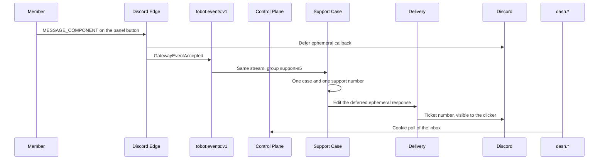

# Tobot S5 — Support

[Roadmap](../26-implementation-roadmap.md) · [Method](../25-implementation-roadmap-method.md) · [S4 ledger](S04-community-xp.md)

## Plan status

| Attribute | Value |
|---|---|
| Status | WP1–WP5 implemented and verified locally. WP6 live Discord demo is Partial: publish, open, duplicate-open, claim, close, reopen, and queued recovery were observed; token-mismatch and exact crash-window steps remain open. S0 release gates stay Partial. S1 stays demonstrated. S2's welcome outcome stays demonstrated; its SIGKILL and blocked-channel demo steps stay open in that file. S3's one-role outcome stays demonstrated; its replay, bot-join, SIGKILL, and remaining publish rejections stay open in that file. S4's XP outcome stays demonstrated; a bot message in the published channel and the SIGKILL of Control Plane stay open in that file. |
| Slice | S5 — Support |
| Outcome | A member opens one ticket from one Discord button, and staff claim and close that ticket from the inbox on `dash.*`. |
| Normative inputs | 02 Support Policy, Support Panel, Support Case; 20 §31.6–31.13, §31.16–31.17, §31.25, §31.28; 05 §10.23 and §10.24; 03 §8.27 and §8.28; 14 invariants 92 and 93, and the §25 rows for these three modules; 13 the support rows named in §7. |
| Not opened | Support Resource Orchestrator, Support Archive, Form Workflow, and doc 10 beyond the tables this slice creates. |
| Inherited from the running slices | Cookie origin is `dash.tobot.test`. Product Discord HTTP stays on Delivery. `GET /gateway/bot` stays on Edge. One stream `tobot:events:v1`. Consumer groups `query-status-s0`, `case-status-s1`, `lifecycle-s2`, `assignment-s3`, `role-status-s3`, `progression-s4`, and `xp-status-s4` are not renamed. Cases, Lifecycle, Assignment, and Progression stay inside Control Plane. No fourth process. Delivery already ignores an envelope leaf it does not reconcile, so a new support fact does not pause welcome nonce reconciliation. |
| Explicit dependency | S1. The dashboard session is the staff actor. A Discord role is not that authority. |
| Next-slice decision | The S5 twin-track outcome is demonstrated, so S6 planning and implementation may proceed under 26 §1. WP6 remains Partial and S5 is not signed off: the pending live checks stay in this ledger and must not be represented as passed by S6 work. |
| S0 release gates | Stay open. This plan does not mark them Complete. |

This is an implementation plan, not an amendment to RFC sections 01–23. Where it conflicts with an RFC, the RFC wins.

26 §1 asks for a ticket panel in Discord and a ticket inbox on `dash.*`. The choice is one button on one panel message, and one case that staff claim and close in the inbox.

A string select is the presentation not taken. One option does not need a menu. Switching to a select would be a new revision and a second component mode.

A private channel is the path not taken. §31.20 makes a private channel the normal resource, and §10.24 reaches `Open` after that resource is active. This slice's template declares no required provider resource, which §31.20 allows the template to do. Admission therefore commits the case as `Open` with a support number and no channel. Support Resource Orchestrator stays closed: no channel create, no thread, no permission overwrite. The case lifecycle does not read a Discord channel to decide whether the ticket exists.

## 1. Outcome

One Discord path and one `dash.*` screen:

- Discord: one published message carries one button. A member click opens one ticket and the member sees an ephemeral line with that ticket's number.
- `dash.*`: an inbox for the selected guild. The operator publishes the panel. The inbox then lists tickets and lets the operator claim and close one. It does not open a ticket itself.

The click is an interaction. Edge defers it before the case write, inside the existing 3-second budget. The dashboard publish returns when the panel revision is durable and the message create is confirmed. It does not wait for a later click.

## 2. Enabled modules

The install permission union does not grow. The string for a new install or repair stays `1099780066304`.

The Gateway identify does not grow. It stays `GUILDS`, `GUILD_MEMBERS`, and `GUILD_MESSAGES`. A component interaction does not require a new intent.

- Generations that are already `Installed` stay `Installed`. This slice does not repair them and does not add Manage Channels.
- Repair still admits only `Degraded` or `Removed`.
- One Edge deploy is required. Today a non-command interaction returns before any callback, so a button click never receives a response. The deploy accepts one button interaction and still accepts `/probe` and `/timeout`. It is not a new privileged intent.

## 3. Services and crates

No fourth process. Support Policy, Support Panel, and Support Case live in Control Plane. Delivery owns the panel message and the ephemeral edit. Assignment and Progression are not callers.

| Place | Change |
|---|---|
| `tobot-persistence` | `SupportStore` for the template revision, the panel binding, the case, the support number, and the support outbox. Existing facades do not gain these methods. |
| `tobot-envelope` | Parse the leaves in §4. Resource, archive, select, and waiting names fail closed. |
| `tobot-discord-adapter` / Delivery | One new typed create: a channel message with plain text and one button. One edit of the deferred ephemeral interaction response. No select, no modal, no channel create. |
| Discord Edge | Accept interaction type `MESSAGE_COMPONENT` for a button. Defer it as ephemeral, then store the click. Leave `/probe` and `/timeout` on their current path. |
| Control Plane | Publish the template and the panel. Consume `support-s5`. Admit one case. Claim and close from the inbox. Project ticket status for the dashboard. |
| `dash.*` | Guild home links to the ticket inbox. English copy. |

A killed Control Plane worker resumes the same interaction. The case insert is the commit. A second delivery of the same interaction does not insert a second case or a second number.

## 4. Inbound contracts

Commands that parse:

| `schema_name` | Who admits it |
|---|---|
| `PublishSupportPanel` | Control Plane, from the dashboard. One guild, one channel id, one button label. |

Facts that parse:

| `schema_name` | Meaning |
|---|---|
| `GatewayEventAccepted` | Already live. A button click is the open input once Edge stores it. |
| `TicketTemplatePublished` | The immutable template. One open case per member. No form, no cooldown, no Discord resource. |
| `SupportPanelPublished` | The panel revision is bound to one owned message and one opaque button token. |
| `SupportPanelInteractionAccepted` | The click matched that binding. It is not yet a case. |
| `SupportCaseOpened` | One case and one support number were committed. |
| `SupportCaseClaimed` | A dashboard claim won the compare-and-set from `Open`. |
| `SupportCaseClosed` | The case is terminal and the member may open another. |

Discord documents a button as component type `2` inside an action row of type `1`. The click is interaction type `3` (`MESSAGE_COMPONENT`) with `component_type` `2` and the button `custom_id`. This slice sends one primary button. It does not send a link button, a select, or the components-v2 flag `32768`.

`GatewayEventAccepted` for the click carries `channel_id`, `message_id`, `custom_id`, `interaction_id`, and `member_id`. It does not carry the interaction token as a durable case field. The token stays on the interaction receipt long enough to edit the ephemeral response.

Edge responds with callback type `5` (`DEFERRED_CHANNEL_MESSAGE_WITH_SOURCE`) and message flag `64` (ephemeral). The later edit is `PATCH /webhooks/{application.id}/{interaction.token}/messages/@original`. A follow-up that only exists to replace that deferred loading state is not a second message.

A click whose `custom_id`, message, channel, or application does not match the published binding writes nothing and edits the ephemeral response to a rejection. The token is not authorization. The binding row is.

Inside a matching click:

- The first click by a member with no `Open` or `Claimed` case inserts one case, allocates the next support number, and emits `SupportCaseOpened`.
- The same `interaction_id` again returns that case and does not allocate another number.
- A different click while that member still has an `Open` or `Claimed` case allocates nothing and emits no case. The ephemeral response says a ticket is already open.

Fail closed, and do not admit as live commands or facts:

- Every `SupportResource*` name.
- Every transcript and `SupportArchive*` name, including `SupportTranscriptRequested`.
- `SupportCaseWaiting`, `SupportCaseEscalated`, `SupportCaseResolved`, `SupportCaseReopened`, `SupportCaseBlocked`.
- `SupportIntakeRequested` and every form name.
- A string-select panel, a second button, a modal, and a cooldown above zero, under any field of `PublishSupportPanel`.

`PublishSupportPanel` rejects:

- A missing or blank channel id, or a channel id that is not a snowflake.
- A button label that is empty, longer than 80 characters, or contains `@everyone` or `@here`.
- `cooldown_seconds` other than 0.
- A select mode, a form reference, a staff role id, or a parent category id.

The panel idempotency key for the click is the Discord `interaction_id`. The case stays pinned to the template revision that the button bound. A later publish does not edit that revision and does not retarget a case that is already open.

Claim and close are dashboard commands on the case version. Claim moves `Open` to `Claimed` only when the stored version matches. Close moves `Open` or `Claimed` to `Closed` and releases the member slot. A stale version changes nothing. The opener has no close command.

## 5. Outbound Discord

Delivery exposes two operations to Control Plane. Support Panel calls the create. Support Case calls the ephemeral edit.

| Operation | Discord effect |
|---|---|
| Create the panel message | `POST /channels/{channel.id}/messages`. Plain text plus one action row and one button. The button `custom_id` is the opaque token from §4. |
| Edit the deferred click | `PATCH /webhooks/{application.id}/{interaction.token}/messages/@original` with flag `64` preserved from the defer. Body is the ticket number, the already-open rejection, or the unknown-button rejection. |

`403` or `400` on the panel create leaves the revision unpublished. A lost response is reconciled by the message nonce already used for welcome before a second `POST`. There is no second panel message for the same revision.

No `PUT` of a role. No `POST` of a channel. No overwrite.

## 6. Data

Migration `0022` owns schema `support`. Migration `0023` adds the Query projection. Do not edit `0001`–`0021`.

Support owns:

- `ticket_template`: one template per guild.
- `ticket_template_revision`: immutable. Pins member capacity `1`, cooldown `0`, and required resource `none`. One `Published` row per tenant.
- `support_panel_revision`: immutable. Pins the channel id, the button label, and the template revision. One `Published` row per tenant.
- `support_panel_binding`: the owned message id, the opaque `custom_id`, and the application id. The panel is `Published` only after this row exists.
- `support_case`: unique on `interaction_id`. States `Open`, `Claimed`, `Closed`. Optimistic `version`. `support_number` unique per tenant.
- `support_number`: the tenant counter, incremented in the same transaction as the insert.
- `event_outbox`.

A partial unique index allows one `Open` or `Claimed` case per tenant and member. `Closed` does not occupy that slot.

Query owns `query_status.support_ticket`: tenant, case, number, member, state, version, and watermark. The inbox reads that projection. It does not read `support` tables.

Not created: resource operations, channel bindings, overwrites, intake answers, transcripts, cooldowns, and schedules.

The admission transaction reserves the member slot, allocates the number, inserts the case, and appends `SupportCaseOpened` together. A rejected click does not insert a number.

## 7. Tests

Copied from 13 for this slice:

- A support panel revision and its option pin an immutable template revision. A later template publish does not change an already opened case.
- A component interaction cannot cross tenant, panel, message, application identity, binding generation, revision, option, or member context. A mismatched `custom_id` creates no case.
- Concurrent open requests cannot exceed the member capacity and cannot allocate duplicate support numbers. The capacity in this slice is one `Open` or `Claimed` case per member.
- A duplicate interaction creates one case and one number.
- A rejected admission creates no case and no number.
- A committed case remains after the panel message is not consulted. The case row does not depend on the Discord message still existing.
- Claim and close reject a stale case version.
- The opener has no close command. A Discord staff role is not accepted as the dashboard actor.

Not opened from 13: uncertain channel or thread creation, permission-overwrite convergence, cleanup of an owned channel, and transcript completeness.

PostgreSQL proofs use `tobot_test`. They do not connect to the live `tobot` database.

## 8. Explicitly out of scope

- A string select, a second button, a modal, and an intake form.
- A private channel, a thread, a category, a permission overwrite, and Manage Channels.
- Transcripts, message capture, and Support Archive.
- Waiting, escalation, resolution as a separate state, reopen, tags, priority, and service-level timers.
- A cooldown, a schedule, a blacklist, and a per-role cap.
- Claiming or closing from a Discord button on the ticket. Those actions are the inbox.
- A fourth process, a second Redis stream, or a rename of the consumer groups named in the status table.
- Closing any S0 release gate. Closing the open S2, S3, or S4 demo steps.
- Force-degrading an `Installed` guild. The permission union did not grow.

## 9. Demo script

1. Sign in on `https://dash.tobot.test`. Open an installed guild. Publish one text channel and one button label.
2. Discord shows that message with one button. The inbox shows the panel as published only after the message id is stored. The two `Installed` generations stay `Installed`.
3. Click the button with a non-bot account. Discord shows an ephemeral ticket number. The inbox shows that ticket `Open` with number 1.
4. Click the button again before the ticket is closed. Discord says a ticket is already open. The inbox still has one ticket.
5. Claim it in the inbox. The row becomes `Claimed`. Repeating the claim with the old version does not change the row.
6. Close it. The row becomes `Closed`. The same member can open again and receives number 2.
7. A click whose button token does not match the binding creates no ticket.
8. Stop Control Plane with SIGKILL after the ephemeral defer and before `SupportCaseOpened`. The restarted process writes that ticket once, in under 60 seconds, and does not allocate a second number.

## 10. Work packages

Implement in this order. A later package may be reviewed early. It does not merge against an open contract from an earlier package.

### WP1 — Contracts

Add `PublishSupportPanel` and the facts in §4. Fail closed the names §4 lists.

**Exit:** a resource name, a transcript name, a select mode, a form reference, and a cooldown do not parse as a live publish. Envelope tests cover the leaves that do parse.

### WP2 — Template, panel, and case

Add `SupportStore`, migrations `0022` and `0023`, and the publish path. A publish supersedes; it does not update the published button label in place.

**Exit:** the immutability proof, the duplicate-interaction proof, the second-open rejection, the mismatched-token proof, and the stale claim proof pass on `tobot_test`.

### WP3 — Panel message and button click

Create the one-button message through Delivery. Edge defers a `MESSAGE_COMPONENT` click and stores the fields in §4.

**Exit:** a button click is a `GatewayEventAccepted` and has a type `5` ephemeral defer. `/probe` still responds. Identify is unchanged. The panel create sends one button and no select.

### WP4 — Admission

Consume `support-s5`. Edit the deferred response with the ticket number or the rejection.

**Exit:** one accepted click creates one case and one number. A second open click for that member creates none.

### WP5 — Inbox

Add the dash page, the channel list used by Welcome, the publish form, and claim and close. Link it from guild home.

**Exit:** an unauthenticated request is 401. A foreign tenant is no-access. The page shows the ticket number and state.

### WP6 — Demo

Run §9 on one live guild. Record the case id, the support number, and the panel message id in §11. Leave S0 gates Partial. Leave the open S2, S3, and S4 demo steps in those files.

**Exit:** the eight demo steps have a recorded result. Live `Installed` rows that were not repaired stay `Installed`.

## 11. Execution tracking

Updated as packages land. A package is Complete only when its exit evidence exists. S0 gates stay Partial. Open S2, S3, and S4 demo steps stay in their own files.

| Package | Status | Evidence |
|---|---|---|
| WP1 — Contracts | Complete | `cargo test -p tobot-envelope`: `support_panel_contract_is_one_button_and_fail_closed` passes. |
| WP2 — Template, panel, and case | Complete | `TOBOT_TEST_DATABASE_URL=.../tobot_test TOBOT_REQUIRE_POSTGRES=1 cargo test -p tobot-persistence --test postgres_support`: four tests pass for immutable revisions, token mismatch, duplicate and concurrent admission, number allocation, nonce reconciliation, supersession ordering, projection, and stale case versions. Migrations 0022–0023 applied only to disposable `tobot_test`. |
| WP3 — Panel message and button click | Complete | `cargo test -p tobot-discord-adapter`: a single primary button serializes as action row type 1/button type 2; ephemeral defer serializes as callback type 5/flag 64. `cargo check --workspace` passes with the Edge component path; `/probe` and identify code remain on their existing paths. |
| WP4 — Admission | Complete | `support-s5` consumes the deferred click and edits its original response through Delivery. The PostgreSQL proofs above confirm one case/number for duplicate and concurrent clicks and no number for a mismatched button. |
| WP5 — Inbox | Complete | `pnpm --filter @tobot/dash check` and `pnpm --filter @tobot/dash build` pass. The inbox reuses the S1 cookie/CSRF and guild-access guards, lists the Query projection, and sends versioned claim/close commands. |
| WP6 — Demo | Partial | The 2026-09-25 panel, tickets #1–#3, and the SIGKILL-before-click stay recorded. On 2026-11-09 a click with custom id `support:wrong` returned `UnknownButton` and left `support_number.next_number` at 5. Ticket #5, case `01a1bf07-3fc4-7793-be44-6003f3b21c11`, was claimed at version 1; repeating the close at version 1 left it `Claimed`; closing at the claimed version left it `Closed`. The after-defer SIGKILL stays open: no live click was in that window. Generation 11 stayed `Installed`. |

### WP6 carry-forward decision

These checks are **not blockers for starting S6**: S5's Discord button, ephemeral response, persisted case, and dashboard claim/close outcome were observed end to end. They remain **blockers for marking WP6 and S5 Complete**, and must be resolved in S5 rather than silently counted as S6 evidence.

| Open evidence | Current evidence | Closure required in S5 |
|---|---|---|
| Stale claim version, §9 step 5 | On 2026-11-09 ticket #5, case `01a1bf07-3fc4-7793-be44-6003f3b21c11`, was claimed at version 1. Closing it again at version 1 left the row `Claimed`. Closing at the claimed version then left it `Closed`. | Closed. |
| Mismatched button token, §9 step 7 | On 2026-11-09 `admit_click` with custom id `support:wrong` on panel message `1552591485075988531` returned `UnknownButton`. `next_number` stayed 5 until the later proof ticket. | Closed for the admission decision. A Discord client did not send the click. |
| Exact crash window, §9 step 8 | SIGKILL before the click demonstrated queued recovery and one ticket; it did not kill Control Plane between the defer and `SupportCaseOpened`. | Run the specified after-defer crash window and record the response, elapsed recovery time, and single case/number. |
| Two `Installed` generations, §9 step 2 | Generation 11 remained `Installed`; generations 9 and 10 were already `Degraded` before this demo. | Use a fixture with two baseline `Installed` rows, or explicitly amend this demo criterion and record the baseline and result. |
