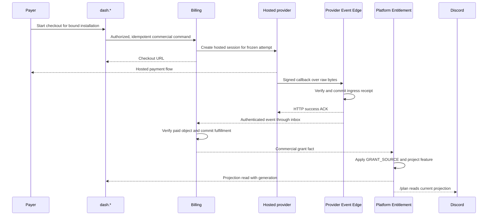

# Tobot S7 — Commercial billing and platform entitlement

[Roadmap](../26-implementation-roadmap.md) · [Method](../25-implementation-roadmap-method.md) · [S6 ledger](S06-guild-ledger.md)

## Plan status

| Attribute | Value |
|---|---|
| Status | Local implementation in progress. Provider Edge, Billing, Commercial Catalog, entitlement, dashboard, and `/plan` compile. WP1C now has per-product revisions, an Admin capability selector, Dash offer selection, and benefit components through Billing and Platform Entitlement. Targeted disposable-DB tests pass; browser publication/selection and Stripe test-mode paid-checkout evidence remain pending. |
| Slice | S7 — second conserved money plane |
| Outcome | Admin publishes multiple configurable recurring base-plan offers. An authorized payer chooses one offer in hosted Checkout. Verified payment grants that offer's pinned capabilities to one Discord installation; dashboard, module admission, and `/plan` read the resulting projection. |
| Normative inputs | 02 §§7.43, 7.52–7.55 and DR-046, DR-051–058, DR-067; 03 §§8.1–8.2, 8.6, 8.43–8.45 and DR-065, DR-069; 04 §§9.36, 9.47; 05 commercial and grant-source state machines; 10a §12.14.2; 23 §§34.3, 34.8–34.13; 13 payment-ingress, owner, invoice, dunning, refund/dispute, and entitlement tests; 14 §25. |
| Entry evidence | S6 demonstrated conserved postings, idempotent income settlement, two live `/daily` claims, and honest wallet reads of 110. S6 WP6 is still Partial: cross-account/foreign-guild browser isolation, kill-before-commit, Earnings worker loss, and full journal-to-projection rebuild are unrecorded. These remain S6 gates, not S7 evidence. |
| Boundary | `CommercialPayment` is separate from guild `VirtualPayment` and `AiCreditReservation`. Billing does not credit guild wallets, write AI lots, or grant features directly. |
| Next slice | S8 remains closed until authenticated paid ingress, idempotent commercial fulfillment, grant-source application, and an authoritative entitlement read are demonstrated. |

This is an implementation plan, not a revision of RFC 01–23. The RFC wins if this plan differs. The running dashboard origin is `dash.tobot.test`, which implements the normative `app.*` surface for this slice. First implementation uses a **Stripe test-mode adapter** and permits multiple published recurring base-plan offers; an installation may purchase one base plan. Admin creates and manages Stripe test Products and Prices, assigns validated benefits per offer, and publishes each offer's immutable terms. No product name, price, or benefit value is baked into the runtime. This document invents no live price or tax registration. The test adapter refuses live API keys.

## 1. Outcome and scope

- **Dashboard:** a signed-in Account-type billing owner, separately authorized for the target installation, sees all eligible published base-plan offers, selects one, and starts hosted Checkout for that immutable revision. The return page reports **Pending verification** until Billing and Platform Entitlement have committed and Query has caught up. It then shows the actual feature and limit state, projection generation, and source watermark. A canceled or failed attempt never displays Active.
- **Discord:** `/plan` returns an ephemeral, guild-scoped summary of whether the S7 feature is available from the current Platform Entitlement snapshot. It reveals no payer identity, invoice, price, provider object, or billing-owner membership. This is a read path, not a Discord storefront or checkout.
- **First product class:** recurring base plans only, with one purchased base plan per installation. Each offer has its own stable product key, revision, Price reference, and typed feature, limit, and perk components. Admin sets values from a server-owned registry of supported capabilities; unknown keys, units, aggregation rules, or values outside safe bounds reject. At least one existing module must consume an effective feature or limit in its admission path before S7 claims commercial benefits work. A Billing row, `GRANT_SOURCE.state`, browser return, or provider-event ACK cannot authorize it.

### Scope correction — configurable offers

The original S7 implementation published only `product_key=base`, `feature_key=platform.base`, and one globally active Price. The WP1C implementation replaces that limit with per-product revisions and configured benefit components. The existing Pro test Checkout still proves only hosted-session creation; it is not proof that a purchased tier changes bot behavior. Browser and paid-provider evidence remain required before WP1, WP4, or WP5 can be marked complete.

The correction is a mechanism, not seeded Pro/Business configuration:

1. A server-owned capability registry describes supported feature switches, numeric limits with units and bounds, and non-quantitative perks with their owning module. Admin reads the registry and assigns values per product revision. Stripe remains the price/payment source; Tobot owns benefit definitions and publication.
2. Each published base-plan revision pins one provider Price and a validated benefit vector. Publication is independent per stable product key; a successor retires only its own prior revision. Orders keep their chosen revision even after later catalog edits.
3. Dash lists eligible active offers with price and benefits. Checkout sends the chosen revision id; Control Plane resolves it against the active catalog and rechecks installation authority. It never trusts posted price, Product id, benefit values, or provider customer id.
4. Verified Billing fulfillment emits that order's pinned benefit vector as typed grant-source components. Platform Entitlement preserves contributors, computes effective features/limits/perks, and owning modules enforce supported limits at admission. Cancellation, dispute, and refund reverse or freeze the same components.
5. An installation with an active base plan cannot start a second base-plan Checkout. Upgrade/downgrade and add-on purchase stay outside S7 and require their RFC transition rules. Dash must explain that limitation without presenting a second purchase as an upgrade.

The first wired numeric capability, `support.max_open_tickets`, proves atomic admission in test mode. S5's current free support path has no capacity ceiling, so this key is **not yet a customer-facing upgrade**. Before a paid offer advertises it as increased capacity, define and enforce an Admin-configurable free baseline and verify that the paid quantity exceeds it, or wire a different genuinely incremental capability. The test catalog must not imply that an active-ticket cap increases an unlimited free allowance.

The first paid path includes renewal, payment failure, grace expiry, cancellation, refund, and dispute **observations** because those can affect an active recurring grant. Self-service upgrades, proration, mixed bundles, and initiating refunds are not UI features in S7. Incoming refund/dispute events must still produce the distinct Billing state and grant reversal/freeze required by the RFC; unsupported or ambiguous provider states create a reconciliation case and suspend new grants rather than being silently ignored.

## 2. Services, data, and credential boundary

S7 adds **two separate private failure domains** to the local stack: `tobot-provider-event-edge` for the public callback endpoint and `tobot-billing` for commercial state and provider API calls. Each has its own migrations, database (or independently writable schema/credential in deployment), inbox/outbox, health circuit, and least-privilege service credential. The preferred local Compose layout uses `tobot_provider_event_edge` and `tobot_billing` databases, separate from the existing platform and Ledger databases. Only Provider Event Edge exposes the callback route; Billing has no public payment-webhook listener. Edge holds only the applicable webhook verification secret generation. Billing holds the restricted test-mode provider API credential. Neither receives a Discord bot token or Ledger write credential.

Commercial Catalog and Platform Entitlement can initially run in Control Plane workers, but own separate tables, inboxes, outboxes, migrations, and write paths. Catalog publishes immutable provider-neutral revisions; it never calls Stripe. Billing owns payer, scope binding, provider-customer mapping, order, attempt, invoice, subscription, refund, dispute, dunning, tax evidence, and provider reconciliation. Platform Entitlement alone applies `GRANT_SOURCE` and publishes `PlatformEntitlement*` projections and invalidations. Query may cache those projections with explicit generation and freshness. Cross-owner communication uses typed commands or durable facts; there is no cross-database SQL join or shared mutable entitlement flag.

Installation remains the sole TENANT minting owner. `tenant_id`, Discord guild id, `billing_owner_id`, and provider Customer id are different identities. A binding is activated only after current installation and billing-owner authority are verified; at most one Active billing scope binding exists per Discord installation. Guild Manage Guild authority alone does not confer payment authority, and Billing membership alone does not confer guild administration. The first onboarding path requires both capabilities for binding and checkout, with current backend revalidation. A removal or ownership change invalidates the affected read/checkout authority and enters explicit reconciliation; it never transfers a paid grant by changing a client field.

Provider objects, raw signed bytes during bounded verification, tax/location evidence, and signatures are protected data. Persist only required provider references and normalized facts in ordinary rows; no card data, secrets, signed payloads, billing identity, or raw provider responses enter Discord messages, Query public fields, logs, or traces. Test and live credentials, endpoint generations, merchant scope, and customer mappings are isolated.

## 3. Contracts and admission

| Boundary | S7 rule |
|---|---|
| Public commercial commands/facts | Use `schema_family: "CommercialPayment"` and the applicable §8.6 leaf; Billing validates immutable `commercial_id`, `billing_owner_id`, installation scope, currency and integer minor-unit amounts. Do not invent an unprefixed `Payment` or `Catalog` public type. |
| Provider ingress | Provider Event Edge authenticates exact raw request bytes, signature, timestamp, endpoint generation, environment and merchant scope before parsing. It commits a unique provider-event receipt before success ACK. Duplicates reuse the receipt and ACK; invalid, expired, or unknown generations reject. |
| Checkout command | The dashboard supplies a catalog product key/revision choice and bound installation, never a price, provider Customer id, payment result, entitlement flag, or owner id as authority. Billing freezes a `COMMERCIAL_ORDER` by semantic key and one `CHECKOUT_ATTEMPT`; at most one non-terminal attempt exists. Provider `client_reference_id` is the attempt id. |
| Fulfillment | `checkout.session.completed`, a success URL, return-page GET, session lookup from the browser, and webhook ACK can complete or correlate an attempt, never fulfill an order. Only an authenticated paid provider observation or admitted reconciliation state may advance the commercial state and emit one semantic grant fact. |
| Entitlement | Billing facts are inputs, not grants. Platform Entitlement applies one `GRANT_SOURCE` by source kind/ref/version before publishing `PlatformEntitlementGrantSourceApplied`, `PlatformEntitlementProjectionPublished`, or `PlatformEntitlementInvalidated`. It rejects `GuildRewardEntitlement*` and all unprefixed `Entitlement*`; guild reward handlers reject `PlatformEntitlement*`. |
| Feature admission | `/plan` and the dashboard read a scoped snapshot with generation, `computed_at`, `valid_until`, source refs, and grace state. On stale, missing, invalidated, or conflicted projection, the feature is unavailable or explicitly Pending; Billing `PastDue` and reconciliation health never authorize it. |

Billing uses the §8.6 `CommercialInvoiceOpened`, `CommercialInvoicePaid`, `CommercialInvoiceVoided`, and `CommercialInvoiceUncollectible` leaves for invoice facts. Provider Event Edge uses its §8.6 `ProviderEvent*` leaves. Checkout/order/subscription details travel in typed `CommercialPayment` payloads and owner commands, without treating a Stripe event name as a canonical `schema_name`. This slice does not publish `VirtualPayment` or `AiCreditReservation` facts from Billing or Entitlement.

## 4. Commercial state and recovery

Each selected Catalog offer pins its recurring product revision, benefit components, interval, provider Price reference, currency, regional availability, tax classification, and bounded payment-failure policy. `proration_mode` is `None`. Billing creates or reuses one Active `PROVIDER_CUSTOMER_MAPPING` for `(billing_owner, adapter, merchant account, environment)` and one frozen order per semantic request. Checkout-creation uncertainty is reconciled using the same provider idempotency key before a new attempt can be admitted. A `Completed` attempt cannot be retried as a new session until verified provider state classifies it as non-fulfilling.

Billing's invoice identity is a platform id; provider invoice id is evidence. Initial invoice Paid plus eligible subscription state yields a grant for the bound scope. Renewal Paid extends the existing subscription period through a new versioned grant fact, not a second initial purchase. A failed renewal records `PastDue` and an explicit `grace_until`; Entitlement may project `Grace` only from that applied fact and never past that deadline. Catalog-pinned dunning attempts target the same Open renewal invoice strictly before `grace_until`. At expiry without verified Paid, Billing marks the invoice Uncollectible and subscription Restricted; Entitlement expires access. Provider collection HTTP success or failed-invoice callback ACK alone makes none of those transitions.

Cancellation and pause observations update Billing's subscription machine and publish the effective grant change. Verified refund success uses a separate append-only `COMMERCIAL_REFUND` and reverses the relevant grant without rewriting a Paid invoice or Fulfilled order. A verified dispute opens a separate `COMMERCIAL_DISPUTE` and freezes the grant; a later result is reconciled according to that machine. A refund cannot be initiated while a qualifying dispute is open. The S7 dashboard has no refund/dispute action, but the read state must show a safe, non-sensitive access outcome. Unknown event versions, out-of-order events, and incomplete provider payloads are retained with bounded reason and reconciled by object identity/version before any grant change.

Each owner commits its own state transition, idempotency receipt, and outbox fact in one local transaction. Event publication, Billing apply, and Entitlement apply are separate at-least-once steps. Replayed receipts cannot produce a second commercial fulfillment or a second applied grant. Worker due sweeps use bounded, tenant-fair fenced leases; an in-memory queue is only a wake-up hint. A provider outage or Query lag results in Pending/Degraded with a recoverable correlation id, never a fabricated Active state.

## 5. Dashboard and Discord path

The `dash.*` billing screen lists all active, eligible base-plan offers with their price, currency, interval, and configured benefits. The buyer selects one revision for the target installation. The screen shows checkout action, pending verification, effective feature and limit state, grace/restricted state, and an invoice/subscription summary sourced from Billing and Query. It must distinguish “payment observed, entitlement pending” from “entitlement active.” Checkout and binding mutations require the existing session, Origin, CSRF, tenant predicate, Billing membership, installation capability, and fresh server-side authorization; high-risk ownership, refund, secret, or dispute mutations require the §34.5 step-up boundary if added later. GET and return routes mutate nothing. Checkout URL is accepted only from the provider adapter's allowed host/route and opened by navigation, not rendered as trusted HTML.

`/plan` is registered through the existing guild command-install path. Discord Edge defers ephemerally, Control Plane resolves the current installation/tenant and reads the latest valid Platform Entitlement snapshot, and Delivery edits the original response. It reports “Active”, “Grace until …”, “Pending verification”, or “Unavailable” for the selected base plan and its safe-to-disclose effective benefits, using Discord's relative timestamp format only for a real server-derived deadline. It never starts payment, exposes a payment link, or treats a member's guild role as billing-owner membership. No new privileged intent or bot permission is needed; verify the manifest union before rollout.

## 6. Tests and release gates

Use disposable platform, Provider Event Edge, and Billing databases and Stripe **test mode**. No test points at the live S6 Ledger database or a live payment credential. The S7-specific matrix is:

- **Contracts/ownership:** wrong or absent `CommercialPayment` family, unprefixed names, wrong entitlement prefix, cross-tenant binding, forged owner/customer ids, second Account-type owner, duplicate Active provider mapping, and second Active installation binding fail closed. Integer minor-unit overflow, zero/negative amounts, and mixed hosted modes reject.
- **Configurable offers:** Admin publishes two different managed test Products and Prices with distinct benefit vectors; both appear in Dash. An unknown capability, wrong unit, out-of-bounds quantity, duplicate key, or unsupported product kind rejects. A forged Price/benefit in checkout does not change the selected revision. Revising or retiring one offer cannot mutate an existing order or remove another offer. A second base-plan purchase for an already funded installation rejects until the upgrade workflow exists.
- **Ingress/ACK:** invalid signature, parsed-before-verify body, stale timestamp, unknown generation, mismatched test/live scope, oversized payload, replay, and duplicate event. HTTP success occurs only after a durable Edge receipt and before Billing/Entitlement apply; a killed Edge process on either side of commit yields zero or one durable receipt and no lost acknowledged callback.
- **Checkout/fulfillment:** concurrent same-semantic-key orders and attempts produce one Open order and one active attempt; conflicting replay rejects. Browser success/GET, session completed, delayed unpaid checkout, and ACK never grant. One verified Paid event, repeated and out of order, yields one Fulfilled order, one paid invoice identity, and one grant-source application. Session-creation timeout reconciles before retry.
- **Lifecycle:** renewal Paid, failed renewal with grace, bounded dunning on the same invoice, grace expiry to Uncollectible/Restricted, cancellation/pause, verified refund, and dispute freeze. Refund/dispute keep historic Paid/Fulfilled states; ambiguous or older provider versions require object reconciliation and cannot re-enable a frozen grant. No dunning attempt runs at or after `grace_until`.
- **Entitlement:** Billing cannot write `GRANT_SOURCE`; Entitlement applies it before projection. One duplicate commercial fact cannot create another grant; source lineage and invalidation survive restart. Snapshot expiry, payment grace cutoff, dispute, ownership change, and Query lag fail closed. A module read cannot authorize from subscription `PastDue`, `GRANT_SOURCE.state`, or a posted `entitled` field.
- **Benefits:** after verified payment of either offer, the projection contains exactly the configured components supported by that revision. At least one owning-module command admits below its configured limit and rejects above it. Cancellation, refund, and dispute affect the same component sources without rewriting the paid history.
- **Security/operations:** payment credentials do not mount on Gateway, Discord Edge, Delivery, or Control API; webhook secret does not mount on Billing; Billing listener is private. Billing or Edge loss does not block Discord interaction ACKs or S6 wallet activity. Public metrics and private service routes reject internet/browser access. Test/live environment data never joins across customer mappings.

S7's **release gate** is at least two independently published base-plan offers with different Admin-configured benefits, one selected test-mode paid checkout observed asynchronously, one canonical Billing fulfillment, the chosen revision's applied benefit components, one current Platform Entitlement projection, one owning-module admission check, and both dashboard and `/plan` reading that projection. A successful return page or webhook ACK alone does not pass. Before production charging, separately record merchant-of-record, product/tax classification, applicable registration and calculation evidence, provider account/credential rotation, refund/dispute operations, and the S6 unresolved gates. S6 WP6 remains Partial until its own evidence is recorded.

## 7. Explicitly out of scope

- AI Credit packs, AI provider spend, guild currency purchase/exchange, guild shop, XP rewards, and marketplace fees.
- Organization-type billing owner, multi-installation paid plan, add-ons, bundles, mixed Recurring+OneTime checkout groups, one-time plans, coupon/promotion UI, upgrades, downgrades, and proration. Their unsupported commands fail closed; later slices can implement the normative machines.
- Dashboard self-service refund/dispute actions, ownership transfer, provider portal, and manual grant administration. Incoming provider lifecycle events still receive safe handling as described above.
- A Discord storefront, public payer identity in Discord, card capture by Tobot, live charges during development, and enabling automatic tax collection from a provider flag without registration evidence.
- Treating the S6 WP6, S5 WP6, or older roadmap evidence as completed by this S7 plan.

## 8. Demo script

1. In Stripe test mode, publish two immutable recurring base-plan offers with different Admin-configured benefits. Record environment, merchant scope, selected revision, installation generation, owner/binding ids, and provider endpoint generation. Confirm the provider API credential and webhook secret are mounted only on their owning processes.
2. As an unauthorized account, attempt checkout and read billing details; both reject. As an authorized guild operator, initiate explicit self-enrollment and checkout, then retry with the same semantic key; record one Billing owner, one Open order, and one active attempt. A second base-plan purchase on that installation rejects.
3. Complete hosted test checkout for the selected offer. The return page first shows Pending verification. Deliver the authenticated provider callback; record the durable Edge receipt and ACK time before Billing applies. Record one paid invoice, one fulfilled order with the selected revision, one grant-source row with its components, one entitlement generation, and their correlation ids. Refresh `dash.*` and invoke `/plan`; both show the same Active benefits.
4. Replay the callback, send session-completed without Paid, and send an older provider event. None creates a second fulfillment or grant, and none activates from the browser route. In disposable runs kill Edge before and after receipt commit, then kill Billing after commit but before publish; resume and compare the same identities and projection.
5. Simulate renewal Paid, failed renewal, grace expiry, cancellation, refund, and dispute with signed test events or explicit adapter fixtures. Verify each Billing state and entitlement effect, invoice/order history preservation, and no cross-plane Ledger writes.
6. Remove or change the installation binding in a disposable run. Verify `/plan` and `dash.*` cannot read or start checkout for the wrong scope. Reconcile Edge, Billing, and Entitlement inbox/outbox and projection checkpoints; record zero unprocessed accepted callbacks and no duplicate grant application.

## 9. Work packages

Implement in order. An unresolved owner, event-ingress, or paid-fulfillment invariant blocks a later package from claiming completion.

### WP1 — Configuration, contracts, and scope

Pin the per-product recurring Catalog shape and benefit component registry, `CommercialPayment` payloads, `PlatformEntitlement*` parse rules, provider environment/merchant identity, Account-type owner membership, and installation binding admission. Provision test-mode Products/Prices and protected secret references only after product/currency/tax inputs are provided. Keep S6's remaining WP6 checks in its ledger; do not treat them as S7 passes.

**Exit:** wrong-plane contracts and unauthorized bindings fail; two immutable base-plan offers with Admin-configured benefits are publishable without a live credential; unknown capability keys and invalid quantities reject.

### WP1C — Correct the single-offer implementation

Replace the global `base` revision constraint with one current revision per stable product key and a listing of all active base-plan offers. Relax the Billing table's global Price uniqueness while preventing two concurrently offered revisions for one Price. Add a typed capability registry and per-revision benefit components to Admin, Control Plane, Billing delivery, and immutable order terms. Preserve the current Pro revision and any orders as historical data; do not invent benefits for it or advertise it as a configured tier after the new offer flow is enabled. The cutover must keep already paid grants readable and stop new Checkout against a legacy revision without explicit benefits. Admin must publish a successor with explicit benefits. Reject publication of any newly advertised benefit until its owning module has a working admission read. Price and benefit values are supplied in Admin, never seeded as Pro/Business constants.

**Exit:** two offers can be independently published, revised, retired, listed, and chosen; existing orders retain their original terms; unsupported benefits cannot be sold.

### WP2 — Provider Event Edge

Add the separate binary, database and migrations, public callback route, endpoint generations, exact-byte signature verification, bounds, durable receipt, duplicate ACK, and outbox forwarding to Billing. Wire local reverse proxy without exposing Billing or metrics.

**Exit:** the signature/ACK/kill matrix in §6 proves no acknowledged callback is lost and Billing apply is not on the HTTP critical path.

### WP3 — Billing and hosted Checkout

Add Billing's separate binary, database and migrations; owner/binding/customer mapping; frozen order/attempt; provider-neutral adapter interface and Stripe test adapter; idempotent hosted-session creation and reconciliation. Build typed Control API checkout admission, then add verified paid invoice/subscription fulfillment with inbox/outbox.

**Exit:** one semantic paid fulfillment follows a verified paid state; browser and attempt completion never fulfill; provider uncertainty cannot open a second active attempt.

### WP4 — Lifecycle and Platform Entitlement

Implement the S7 recurring renewal/failure/grace/dunning/cancellation path and safe refund/dispute observations in Billing. Implement `GRANT_SOURCE` component application, generation history, invalidation, reconciliation, and scoped feature/limit/perk projection reads in Platform Entitlement. At least one owning module must apply a configured feature or limit at admission.

**Exit:** the lifecycle and grant-source matrices in §6 pass, including duplicate/reordered events and worker restart; the selected revision's benefits are visible and enforceable, and no direct Billing write can grant a feature.

### WP5 — Twin-track product path

Add the authorized `dash.*` offer list, selected-revision checkout/status screen, and `/plan` ephemeral command. Poll Query with generation/freshness and show Pending until Entitlement has applied. Verify install permission union and existing interaction latency.

**Exit:** a signed-in payer can use test Checkout and see an honest Active result; a guild user sees the same feature state in Discord without billing details.

### WP6 — Recovery and release evidence

Run §6 and §8 on disposable databases and one test-mode provider account. Record ids, generations, state transitions, ACK latency, crash points, reconciliation checkpoints, credential mounts, and negative cases below. Resolve or explicitly carry forward S6 WP6 separately before any production charge decision.

**Exit:** every S7 release-gate fact is evidenced, no acknowledged callback is lost, no duplicate grant appears, and an unresolved payment or projection state cannot display Active.

## 10. Execution tracking

| Package | Status | Evidence |
|---|---|---|
| WP1 — Configuration, contracts, and scope | Partial | Control Plane owns immutable `commercial_catalog.revision` records and a durable delivery outbox. Admin creates Stripe test Products and Prices and publishes one selected Price. Checkout explicitly enrolls the authenticated active Account as its own Billing owner after current guild authority is checked; Admin enrollment is no longer part of the buyer flow. |
| WP1C — Correct the single-offer implementation | Partial, blocks WP4/WP5 completion | Additive platform migrations `0030`/`0031` and Billing migration `0004` add per-product active revisions and benefit vectors while retaining legacy rows. Admin reads the capability registry and publishes each Price with a stable product key and configured benefits. Dash lists offers and posts a selected revision; Control Plane verifies it is active. Billing freezes that revision and emits its components; Entitlement preserves them. Disposable-DB tests cover independent publications, successor replacement, duplicate Price rejection, grant replay, Billing fulfillment, and a support-ticket limit at admission. The local Compose services were rebuilt and restarted with the new migrations; both benefit columns are present. Admin API checks return two supported capability keys and two historical revisions. The active-offer list is currently empty because existing catalog revisions have no configured benefits. Real browser publication and selected paid checkout remain unverified. |
| WP2 — Provider Event Edge | Partial | Separate binary/database, raw-byte signature verification, durable receipt, duplicate ACK and forwarding implemented; two disposable-DB tests pass. On 2026-09-25, Stripe CLI delivered a signed `checkout.session.completed` fixture to `/webhooks/stripe/1`: HTTP 200, one durable Edge receipt, one processed Billing inbox row. An opt-in `billing-dev` Compose listener now runs, and its signing secret was checked against Provider Edge's configured secret without printing either value. This is local CLI forwarding, not a registered Stripe test-mode webhook endpoint. The 2026-11-09 crash record below exercised the same `/webhooks/stripe/1` path with signed `livemode=false` events. |
| WP3 — Billing and hosted Checkout | Partial | Separate binary/database, test-only Stripe adapter, idempotent order/attempt, hosted session, paid-invoice fulfillment and reconciliation implemented. Billing consumes and checks an immutable published revision. Control Plane enrolls the active Account on an authenticated checkout command after current guild authority validation; Billing still requires the persisted owner row. Disposable-DB fulfillment test passes. Real test-mode checkout pending. |
| WP4 — Lifecycle and Platform Entitlement | Partial | Renewal/failure/grace/dunning/cancel/pause/refund/dispute handlers, grant outbox, and Entitlement projection implemented. Benefit components now survive the grant-source and projection path. Support checks a configured `support.max_open_tickets` limit in the same transaction as ticket admission. The 2026-11-09 record below proves the live cap, one renewal, one succeeded refund, one `needs_response` dispute, and one expired grace on the already-reversed subscription. The dunning worker selected that attempt before grace, then left the row `Scheduled` because Stripe returned 404. Owner-loss remains open: checkout and repair return 403 without current guild authority, and no removal path invalidates the entitlement projection. |
| WP5 — Twin-track product path | Partial | Dashboard billing screen lists published offers and sends the selected immutable revision; ephemeral `/plan` reads the projection. Admin manages Stripe test Products/Prices and per-product publications. Astro checks pass. Authenticated selected Checkout, interaction response, and Stripe test-mode UI evidence pending. |
| WP6 — Recovery and release evidence | Partial | Local checks: `cargo check --workspace`, catalog immutability/delivery and Billing fulfillment tests on disposable PostgreSQL, Astro check, Compose config, and a signed Stripe CLI event through Caddy, Edge and Billing. Container environment-name inspection confirms the Stripe API key only in Billing, the webhook secret only in Provider Edge, and neither Stripe secret in Control Plane, Discord Edge, or Delivery. The 2026-11-09 record covers the live ticket cap, renewal, refund, dispute, three SIGKILL restarts, and expired grace. Production charging, owner-loss invalidation, and S6 WP6 remain open. |

### Evidence still required before claiming S7 complete

1. ~~Configure the Stripe test values and a recurring Price in the local `tobot/.env`, then launch the Compose `billing` profile with separate Provider Edge and Billing databases.~~ Done locally with the existing Pro Price and separately generated internal tokens. This is provisional test configuration, not RFC §34.8 catalog publication. Record only non-secret object references in this ledger.
2. Complete one hosted Stripe test checkout. Record one durable provider receipt, one `Fulfilled` order and `Paid` invoice, one applied commercial grant and projection generation, plus the same feature state in the dashboard and `/plan`. A browser return or callback ACK alone does not pass.
3. Renewal, refund, dispute, the live ticket cap, the three SIGKILL checks, and expired grace were recorded on 2026-11-09. The dunning attempt was selected before grace and stayed `Scheduled` after Stripe returned 404 for the synthetic invoice. S6 Ledger was not written by those events. Production charging and S6 WP6 stay open.
4. Removal or ownership change does not yet invalidate the projection. Checkout (`control-plane` `billing.rs`) and guild repair both return 403 when `has_live_guild_install_authority` is false. No `GUILD_DELETE` path updates `platform_entitlement.projection`. The tenant was not deleted and the grant was not transferred. This row stays open.
5. ~~Move Commercial Catalog publication to its owning Control Plane boundary with a privileged, validated command and immutable revision data. Billing must consume that revision rather than publish it from environment at startup.~~ Implemented locally. Supply and approve region, merchant, tax classification, and policy URLs before publishing the test revision. Production checkout separately requires real legal/tax review and live credentials.

### Recorded 2026-11-09, test mode only

Signed `livemode=false` events were posted to Provider Edge `/webhooks/stripe/1`. The signature was made inside that container. No webhook secret or API key was printed. This is not a registered Stripe endpoint and does not enable a production charge. S6 `ledger.monetary_transaction` stayed at 6 rows.

1. **Ticket cap.** Tenant `01a0c9ef-63fe-73a9-9e19-51f7b0728079`, guild `1135838146416881674`, projection Active with `support.max_open_tickets` quantity 5. The free plan stayed at quantity 10 and was not the rule in force. `admit_click` admitted members `910000000000000001` through `910000000000000005` as tickets 1–5. Member `910000000000000006` returned `AtCapacity` and created no row. Member `...0001` then returned `AlreadyOpen`. At 2026-11-09T06:07:06Z the five tickets were closed and the proof panel `01a1beea-e255-745d-b0d6-51a57b5664a0` was left `Superseded`. Open tickets afterward: 0.

2. **Renewal.** Order `01a13d17-d5e7-760b-92c2-5acb6f202006` stayed the only order and stayed `Fulfilled`. `evt_s7renewal20261109a` / `in_s7renewal20261109a` posted HTTP 200 at 2026-11-09T06:08:53Z. The new invoice is `Paid` with `period_end` 2026-12-15T01:06:04Z. The subscription stayed `Active` with `grace_until` empty. Replaying that `evt_` returned HTTP 200, left one Edge receipt, and did not add a third invoice or a third grant.

3. **Refund.** `evt_s7refund20261109a` / `re_s7refund20261109a`, `refund.updated` `succeeded`, amount 499 usd, payment intent `pi_s7renewal20261109a`. `commercial_refund` is `Succeeded`. The renewal invoice stayed `Paid` and the order stayed `Fulfilled`. Grant `re_s7refund20261109a` is `Reversed` and published. At this point the projection was generation 3, sequence 5, state `Reversed`. Item 6 later moved this same projection to `Restricted`. No dispute was open on this order.

4. **Dispute.** Separate order `01a0e424-3368-7539-925e-e9f675a006c4`, tenant `01a0c830-c467-70fb-a89e-40a77dc81748`. `evt_s7dispute20261109a` / `du_s7dispute20261109a`, `charge.dispute.created` `needs_response`. The dispute row was `Open`, the subscription `Disputed`, the grant `Frozen` and published, and the projection generation 3 sequence 6 state `Frozen`. Both invoices stayed `Paid` and the order stayed `Fulfilled`. `/plan` would say access is unavailable while a payment dispute is reviewed; the dashboard label would be `Frozen`, not plan active. After that snapshot, `evt_s7dispute20261109won` closed the same dispute as `won`. The subscription and projection returned to `Active` so this server was not left frozen. The later crash renewals moved that projection to generation 7, sequence 10, still `Active`.

5. **Crashes.** Each cut used `docker kill` and then the same event again.
   - Edge killed while `evt_s7crash1a` was waiting to commit: the POST exited without HTTP 200 and left 0 receipts. After restart the replay returned HTTP 200, one receipt, and one grant for `in_s7crash1a`.
   - `evt_s7crash2a` committed one undelivered receipt, then Edge was killed before Billing published. The replay returned HTTP 200 with the same single receipt. Billing then applied one event and one grant for `in_s7crash2a`.
   - Billing was killed after `evt_s7crash3a` was stored and before any grant row existed (1 event, 0 grants). After restart: one applied event and one published grant for `in_s7crash3a`. The replay left that count at one.

At 2026-11-09T06:15:53Z, Edge had 0 undelivered receipts and Billing had 0 unpublished grants. One older Billing event, `evt_1ULXnxDpGxO2Fh1luJSFichk`, has been unapplied since 2026-10-01 because its subscription has no order. It was not created by these proofs. Provider Edge and Billing were running again at the end.

6. **Expired grace, not the daily server.** Order `01a13d17-d5e7-760b-92c2-5acb6f202006`, tenant `01a0c9ef-63fe-73a9-9e19-51f7b0728079`, still had its subscription `Active` with an empty `grace_until` and `period_end` 2026-12-15T01:06:04Z. Signed `evt_s7fail20261109a` / `in_s7fail20261109a` returned HTTP 200. The subscription became `PastDue` with the original `grace_until` 2026-12-18T01:06:04Z. One dunning attempt, `01a1bf0a-dde9-71b9-b9b6-f8f8f5995716`, was `Scheduled` with the original `due_at` 2026-11-10T06:42:02Z, before that grace. Only that `due_at` was moved earlier. From 2026-11-09T06:42:23Z the worker selected the attempt and Stripe returned 404, so the handler left the row `Scheduled` with `attempted_at` empty. Only then was `grace_until` moved from 2026-12-18T01:06:04Z to 2026-11-09T06:43:05Z. The open invoice became `Uncollectible`, the subscription `Restricted`, and grant sequence 12 `grace-expired-1794206585` was published `Restricted`. The projection is generation 5, sequence 12, `Restricted`, not `Active`. The two earlier invoices stayed `Paid` and the order stayed `Fulfilled`. The guild ledger stayed at 6 transactions.

### Local catalog publication

The operator manages Stripe test Products and recurring Prices at `https://admin.tobot.test/billing`. Billing alone holds the Stripe API key. Admin creates a Tobot offer for each managed Product/Price, assigns supported benefits, obtains provider terms through the private Billing API, and publishes an immutable revision per product key. Billing enables checkout for each offer only after accepting that revision and Control Plane marking it Active. Stripe Price amounts are immutable: create a new Price and revision to change an amount. Referenced Prices cannot be archived. Keep merchant and policy evidence explicit; a placeholder must not be presented as production approval. The former one-Price UI has been replaced locally; its browser behavior still needs verification.

Billing compares the published `txcd_...` classification with the actual Stripe Product `tax_code` and rejects mismatches. The archived legacy Product and Price are not managed by Tobot. The existing Pending revision referencing them must be retired before publishing a new managed Price. Admin shows delivery errors and can retire a bad revision before publishing a corrected immutable revision. This does not enable Stripe Tax calculation or assert a Mexican tax registration.

Admin requires HTTP Basic user `operator` with the separate `TOBOT_ADMIN_OPERATOR_TOKEN` from the ignored local env file. Admin holds the catalog command token, never the Stripe API key. Public legal pages can live on `docs.tobot.test/legal/terms`, `/legal/privacy`, and `/legal/support` after the merchant supplies and approves their text. Until then, the publication form intentionally has no default policy URLs.

For local signed callbacks, Compose profile `billing-dev` adds `stripe-listener`, forwarding to Provider Event Edge on the private network. It uses the Stripe CLI test credential and no public webhook registration. Before starting, compare the CLI `listen --print-secret` result with `TOBOT_STRIPE_TEST_WEBHOOK_SECRET` in the local env; the secret is stable for this test account. The listener suppresses container logs because Stripe CLI prints that secret. The provider endpoint remains `/webhooks/stripe/1`. Production delivery requires a publicly reachable HTTPS endpoint registered in Stripe with its own signing secret.

For the local test, the old `backend/` Stripe variable names and `/api/billing/webhook` endpoint do not configure the S7 services. Use the `TOBOT_STRIPE_TEST_*` names in `tobot/.env.example`, and forward signed test events to `/webhooks/stripe/1`. A Stripe CLI forwarding session supplies its own `whsec_` signing secret; set `TOBOT_STRIPE_TEST_WEBHOOK_SECRET` to the secret for the active S7 endpoint. Keep that secret and the API key out of this ledger and chat.

### Adapter references

The Stripe-specific test adapter should follow the provider's current [subscription webhook guidance](https://docs.stripe.com/billing/subscriptions/webhooks), [webhook signature verification](https://docs.stripe.com/webhooks/signature), and [tax collection setup](https://docs.stripe.com/billing/taxes/collect-taxes). These references inform adapter implementation; the Tobot RFCs above remain the domain authority.
