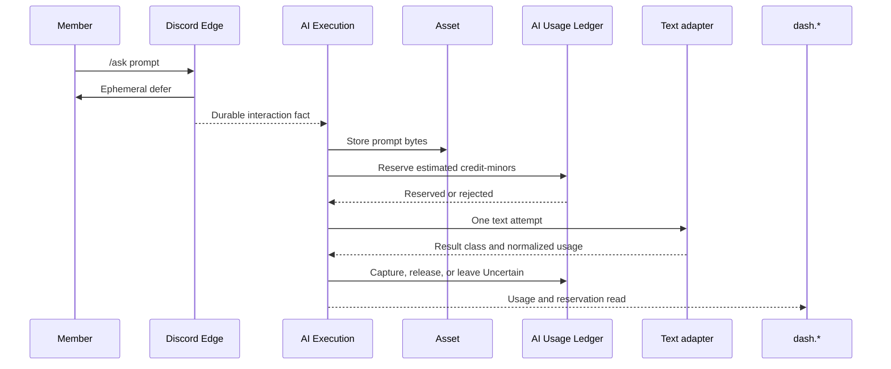

# Tobot S8 — AI Credits and one text operation

[Roadmap](../26-implementation-roadmap.md) · [Method](../25-implementation-roadmap-method.md) · [S7 billing](S07-commercial-billing.md)

## Plan status

| Attribute | Value |
|---|---|
| Status | Local implementation is in place and is not a release-gate pass. On 2026-11-09 `one_grant_reserves_once_and_dispute_is_not_complete` passed on disposable `tobot_ai_s8_matrix`, and `TOBOT_AI_SECRET_KEY` was set only on `tobot-ai`. The live ledger had no `Uncertain` or `Disputed` row. The matching dash read, a displayed `Disputed` row, replay, and the `tobot-ai` SIGKILL stay open. |
| Slice | S8 — third conserved plane |
| Outcome | A member runs one ephemeral text operation in Discord. The call reserves AI Credits before the provider, then captures actual rated usage or leaves the reservation `Uncertain` / `Disputed`. `dash.*` shows that usage and the reservation state. |
| Normative inputs | 02 §§6.2, 7.56–7.57 and DR-003; 03 §§8.1–8.2, 8.6 AI Credits leaves, 8.46–8.47, 8.53, 8.55 and DR-065; 05 §§10.39–10.40, 10.56–10.58; 10a §12.14.3; 23 §§34.14–34.17; 13 lot, reservation, provider, and money-plane tests; 14 invariants 218, 227, 234; DR-016, DR-031, DR-038, DR-061–063, DR-070. |
| Entry evidence | S7 demonstrated one fulfilled test checkout and, on 2026-11-09, the live ticket cap, one renewal, one refund, one dispute, three SIGKILL restarts, and expired grace on the already-reversed subscription. Those records are in `roadmap/S07-commercial-billing.md`. S7 remains open for owner-loss invalidation and production charging. They are not S8 passes and do not authorize a production charge. |
| Boundary | `AiCreditReservation` is separate from guild `VirtualPayment` and `CommercialPayment`. AI Usage Ledger is the only lot and journal writer. Billing, Catalog, and the dashboard cannot mint or edit a lot. |
| Next slice | No later slice is opened by this plan. |

This is an implementation plan, not a revision of RFC 01–23. The RFC wins if this plan differs. The running dashboard origin is `dash.tobot.test`, which implements the normative `app.*` surface for this slice. The chosen operation class is **text generation and transformation**. Image, OCR, transcription, moderation-by-provider, workflow actions, and character responses stay closed.

The text adapter calls the local chat endpoint when `TOBOT_AI_PROVIDER_URL` is set. Otherwise it calls Gemini `generateContent` when `TOBOT_AI_PROVIDER_KEY` is set. The published pricing revision supplies the model id. With neither setting, the fixture adapter answers. No credit price or grant amount is baked into the runtime. The key is not committed and is mounted only on the AI process.

## 1. Outcome and scope

- **Discord:** `/ask` takes one bounded `prompt` string. Discord Edge defers an ephemeral response. AI Execution admits the guild, actor, feature, and spending ceilings, stores the prompt as protected content, reserves the pricing revision's maximum, then calls the text adapter. Delivery edits the original response with the moderated text, an explicit pending state, or a refusal. The reply contains no balance internals, payer identity, provider name, request id, or raw usage payload.
- **Dashboard:** the signed-in member sees their own available and reserved credit-minors, the operation state, and the paired reservation state, including `Uncertain` and `Disputed`. `Disputed` is review. The screen does not present it as succeeded, failed, captured, or released. A member cannot settle, release, or refund from this page.
- **First class:** text only. The admitted tool catalog is empty. The caller cannot choose a provider, a model id, a system prompt, or a generation parameter. One server-owned model class and one immutable pricing revision rate the operation.

Credits enter only through Platform Entitlement. For this slice the mint is one operator compensation grant: Entitlement applies a `GRANT_SOURCE` that carries an integer credit-minor amount and the feature `ai.text`, then publishes the AI-credit grant-source fact. Ledger creates one lot and freezes `expires_at` from that fact. A purchased pack, a plan-price edit, and a rewrite of guild `1135838146416881674`'s paid revision are out of this slice. The already-paid Pro grant stays readable and unchanged.

## 2. Services, data, and credential boundary

S8 adds one private process, `tobot-ai`, hosting AI Usage Ledger and AI Execution. AI Character is not in the process. The process owns database `tobot_ai`, separate from platform, Billing, Provider Event Edge, and the guild Monetary Ledger. Ledger and Execution use separate schemas, inboxes, outboxes, and write paths. There is no cross-schema SQL join and no shared mutable balance column.

Asset is the only durable byte store for the prompt and the moderated output. S8 adds the minimum Asset owner required by DR-063: text bytes, content hash, MIME, and `asset_id`. Execution owns `AI_PROTECTED_CONTENT` and points `input_ref` / `result_ref` at `protected_content_id`, never at `asset_id`. Purposes for this slice are `OperationInput` and `OperationOutput` only. No card renderer, image store, OCR aggregate, or vector table.

The text provider credential mounts only on `tobot-ai`. It does not mount on Gateway, Discord Edge, Delivery, Control Plane, Billing, or Monetary Ledger. Control Plane admits `/ask` and the dashboard read, then uses command-HTTP for reserve, capture, and release. Those calls carry `schema_family: "AiCreditReservation"`. They do not hold the RPC open until Discord delivery finishes.

Accounts are scoped by the installation's billing binding, not by a Discord snowflake and not by the guild wallet. A member read returns only that member's operations inside the current tenant. Guild Manage Server authority does not reveal another member's prompt.

## 3. Contracts and admission

| Boundary | S8 rule |
|---|---|
| Public credit facts | `schema_family` is `AiCreditReservation`. `schema_name` is one of the §8.6 AI Credits leaves. Unprefixed `Reservation` or `Payment`, and any `VirtualPayment` or `CommercialPayment` payload, fail closed at this inbox. |
| Grant mint | Ledger accepts only an Entitlement AI-credit grant-source fact. Billing facts, Catalog revisions, dashboard amounts, and a posted `balance` field do not create a lot. |
| Pricing | One immutable revision for operation class text and the admitted model class. It pins integer credit-minors, the reservation estimate, the maximum charge, and one rounding rule. Settlement cannot exceed the reserved amount. |
| Operation | `operation_class` is text generation. `state` has no `Disputed`. `input_ref` and `result_ref` are protected-content ids. |
| Provider attempt | Classify `ConfirmedResult`, `ConfirmedFailure`, `RateLimited`, `TimeoutNotSent`, `TimeoutAfterSend`, or `Uncertain`. HTTP 429 is `RateLimited`. A timeout after transmit is `Uncertain` and does not release. |
| Feature admission | `/ask` reads the current Platform Entitlement snapshot for `ai.text`. A missing, stale, invalidated, or conflicted projection rejects. `GRANT_SOURCE.state` and Billing `PastDue` do not authorize the command. |
| Tools | The allowlist is empty. Prompt text cannot add a tool, a Discord effect, or an HTTP call. |

Reservation TTL is 15 Clock-port minutes and must cover the operation deadline. Elapsed TTL without a confirmed outcome moves the reservation to `Uncertain` and does not release it. `Uncertain` remains reserved until reconciliation or 24 Clock-port hours, then `Disputed`. While the reservation is `Uncertain` or `Disputed`, the operation stays `Uncertain`. The operation leaves `Uncertain` only after Ledger accepts a confirmed usage receipt into `Capturing` or an absence receipt into `Releasing`.

Lot allocation is earliest `expires_at` first, null last, then `granted_at`, then `lot_id`. A lot already at or past `expires_at` is not eligible. Open allocations survive lot expiry until the reservation settles. The first compensation lot uses the `expires_at` on the grant fact; null means no automatic expiry. A dashboard expiry is rejected.

Spending ceilings that this command can hit are per operation, per user, and per guild. The most restrictive ceiling wins. Workflow and character ceilings are not invented for a command that has neither. Concurrent reservations of the same semantic key produce one operation and one reservation.

## 4. Text execution and recovery

Execution pins the pricing revision before reserve. The provider call happens only after `Reserved`. `RateLimited` and `TimeoutNotSent` may retry on a new `attempt_id` of the same operation, within the deadline, the remaining reservation TTL, and `max_attempts` 3. Adapter timeout stays strictly below both remaining budgets. Retry-After is adapter configuration and must not copy Discord 429 delays. `TimeoutAfterSend` and provider `Uncertain` do not retry and do not fall back to another provider.

A confirmed result rates normalized usage, captures that integer amount, and releases the remainder. A confirmed failure before billable work releases the reservation. Output that fails the platform safety gate can still be billable when the provider performed the operation; Delivery then says the output was withheld, and the dashboard shows the captured charge without the withheld text. Empty and oversize prompts reject before reserve.

Each owner commits its transition, idempotency receipt, and outbox fact in one local transaction. Replayed receipts cannot capture twice or release twice. Worker sweeps use bounded, tenant-fair leases of 15 Clock-port seconds. An in-memory queue is only a wake-up. Killing the AI process before commit yields zero or one durable operation. Killing it after reserve and before a confirmed attempt leaves the reservation reserved until TTL moves it to `Uncertain`.

`Disputed` stays reserved. An operator reconciliation command, with evidence of usage or absence, is the only way into `Capturing` or `Releasing`. The member dashboard cannot send that command. Query must not label the row completed.

Prompt and output bytes stay in Asset. Events, logs, traces, and metric labels carry identifiers, sizes, and result classes. They do not carry the prompt, the completion, or the provider credential.

## 5. Dashboard and Discord path

`/ask` is registered through the existing guild command-install path. No new privileged intent is required; check the manifest union before rollout. The ephemeral edit is the member-visible result. A second identical interaction reuses the same operation and does not reserve again.

The `dash.*` screen lists the member's text operations for the selected guild: operation state, reservation state, reserved amount, captured amount, and generation or freshness of the read. It distinguishes "provider finished, settlement pending" from "captured" and from "reservation in review". Foreign guilds and other members return the same no-access result as the guild shell. GET routes mutate nothing.

The operator compensation grant lives on the existing privileged Admin boundary, with the current admin credential. It submits a grant fact. It does not write Ledger tables and it does not display the provider key.

## 6. Tests and release gates

Use a disposable `tobot_ai` database and a disposable Asset store. Do not point tests at the live guild ledger or the live Billing database. The S8 matrix is:

- **Contracts:** a missing or wrong `AiCreditReservation` family, an unprefixed `Reservation`, a `VirtualPayment` or `CommercialPayment` payload, and a dashboard-posted balance or lot expiry fail closed. Zero, negative, and overflowing credit-minors reject.
- **Lots:** one Entitlement grant-source mints one lot with `expires_at` frozen. A second delivery of the same fact does not mint another. Billing and a direct Ledger insert from a non-grant caller reject. An already-expired lot is skipped. Two lots are consumed earliest-expiry first.
- **Reservation:** insufficient balance rejects with no provider call. Concurrent same-key requests yield one reservation. Confirmed usage captures once and releases the remainder. Confirmed pre-billable failure releases once. TTL expiry enters `Uncertain` and does not release. After 24 Clock-port hours, `Uncertain` becomes `Disputed` and the operation is still `Uncertain`.
- **Disputed:** a `Disputed` reservation does not capture, release, fail, or settle the operation. The dashboard read does not say completed. Only an evidence-bearing reconciliation moves it to `Capturing` or `Releasing`.
- **Provider:** HTTP 429 is `RateLimited` and may retry. Timeout before transmit may retry. Timeout after transmit stays `Uncertain`, does not release, does not retry, and does not fall back. A 5xx without proof the request was not accepted is not `ConfirmedFailure`.
- **Privacy:** prompt and output are absent from logs and span attributes. `input_ref` is not an `asset_id`. A tool request inside the prompt adds no tool.
- **Isolation:** the provider credential is absent from Edge, Delivery, Control Plane, Billing, and Monetary Ledger. An AI process crash does not block Discord ACK or a guild `/daily` read. Guild currency and AI credit-minors cannot settle each other.

S8's **release gate** is one compensation lot, one live or fixture-backed `/ask` that reserves before the provider call, one capture of rated usage at or under the estimate, the same amounts on `dash.*`, plus one demonstrated `Uncertain` that does not release and one `Disputed` row that the dashboard does not show as completed. A Discord reply alone does not pass. S7's open checks stay in S7.

## 7. Explicitly out of scope

- Image generation, image processing, OCR, audio transcription, provider-backed moderation, workflow AI actions, and AI characters. Their operation classes fail closed.
- Credit packs, checkout for credits, plan upgrades, editing a paid catalog revision, and monthly grant renewal. Those remain commercial work.
- A member control that settles, releases, refunds, or expires credits.
- Tool calling, retrieval over guild history, embeddings, and conversation memory.
- Putting the provider credential on Gateway, Edge, Delivery, Control Plane, or Billing.
- Treating S7's open ticket, lifecycle, or crash checks as done.

## 8. Demo script

1. Apply one operator compensation grant for a disposable or designated test installation. Record the grant-source id, lot id, frozen `expires_at`, feature `ai.text`, and credit-minor amount. Confirm the provider credential is mounted only on `tobot-ai`.
2. As a member without `ai.text`, invoke `/ask`. It rejects before reserve. As an entitled member, invoke `/ask` with a short prompt. Record one protected input, one reservation, one provider attempt, one capture at or below the estimate, one remainder release, and the ephemeral reply.
3. Refresh `dash.*`. The same operation shows captured, with matching reserved and captured amounts. Another member and another guild cannot read it.
4. Replay the interaction and the usage receipt. Neither creates a second reservation or a second capture.
5. On a disposable run, force timeout after transmit and a reservation TTL expiry. Record `Uncertain` with the credits still reserved. Advance the uncertainty deadline and record `Disputed` with the operation still `Uncertain`. Confirm the dashboard does not say completed.
6. Kill `tobot-ai` after reserve and before attempt completion. Resume and compare the same operation and reservation ids. Confirm `/daily` and interaction ACK still succeed while it is down.

## 9. Work packages

Implement in order. An unresolved lot-ownership, reserve-before-call, or `Disputed` invariant blocks a later package from claiming completion.

### WP1 — Contracts, pricing, and grant mint

Pin `AiCreditReservation` parse rules, the text operation class, the empty tool catalog, the `ai.text` feature, and one immutable pricing revision whose amounts are supplied at publication. Extend Entitlement so one compensation grant-source can carry credit-minors and that feature, and so Ledger is the only consumer that mints the lot.

**Exit:** wrong-plane contracts and dashboard balance edits fail. One grant fact creates one lot. A second copy does not.

### WP2 — AI Usage Ledger

Add the ledger schema, account, lot, journal, reservation, and allocation tables. Implement atomic reserve, capture, remainder release, confirmed-failure release, TTL to `Uncertain`, and the 24-hour move to `Disputed`. Reject expired lots and wrong consumption order.

**Exit:** the lot and reservation matrix in §6 passes on a disposable database, including duplicate facts and insufficient balance.

### WP3 — Execution, Asset, and the text adapter

Add protected-content rows, the minimum Asset byte store, and one test-mode text adapter with the six result classes. Admit `/ask` only after entitlement, ceilings, and a successful reserve. Retry only `RateLimited` and `TimeoutNotSent`. Leave `TimeoutAfterSend` reserved.

**Exit:** no provider call happens without a reservation. The provider matrix in §6 passes. Prompt text is absent from logs.

### WP4 — Twin-track product path

Register `/ask`, defer and edit through Delivery, and add the member usage screen on `dash.*`. Show `Uncertain` and `Disputed` without calling them completed. Add the operator compensation action on Admin.

**Exit:** an entitled member can run one text operation and see the same captured amounts in Discord and on `dash.*`. A member cannot settle a disputed reservation.

### WP5 — Recovery and release evidence

Run §6 and §8 on disposable databases. Record ids, reservation states, crash points, credential mounts, and the negative cases. Leave S7's open evidence in its own plan.

**Exit:** every S8 release-gate fact is evidenced. No duplicate capture appears. A `Disputed` reservation cannot display as a completed operation.

### Recorded 2026-11-09

The live `tobot_ai` reservation table was read before and after this proof: 46 `Captured`, 6 `Released`, and no `Uncertain` or `Disputed` row. It was not written. No live `Uncertain` reservation was released.

1. **Disposable matrix.** Database `tobot_ai_s8_matrix` on the AI Postgres, owned by a role created for this run. `cargo test -p tobot-ai one_grant_reserves_once_and_dispute_is_not_complete` passed. The test reserves 10, captures 4, replays the same semantic key as one attempt, leaves a timeout `Uncertain` and not completed, sweeps it to `Disputed` with the operation still `Uncertain`, and then its own `reconcile` releases that fixture. The disposable database ended with 1 `Captured` and 1 `Released` reservation. That release is the test fixture, not a live reservation.

2. **Credential names.** `TOBOT_AI_SECRET_KEY` was set on `tobot-ai` and unset on Control Plane, Delivery, Discord Edge, and Billing. `TOBOT_AI_PROVIDER_KEY` was unset on all five. `TOBOT_AI_RECEIPT_KEY` was set on `tobot-ai` and Control Plane; that is the receipt signing key, not the provider credential. No value was printed.

3. **Still open.** No operator session reloaded the AI usage screen, and the live ledger has no `Disputed` row to show. `AiUsageView` maps `Disputed` to “In review”, which is the component text, not a displayed row. No interaction or receipt was replayed. `tobot-ai` was not killed between reserve and attempt completion.
